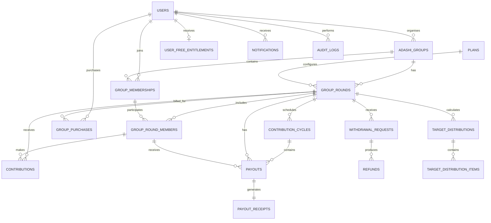

# Adashi Platform — Database Design

**Document:** 02 — Database Design  
**Platform:** Adashi  
**Database:** PostgreSQL  
**Currency:** Nigerian Naira (NGN)  
**Architecture:** Multi-user, multi-group platform  
**Application:** Mobile-first Progressive Web Application (PWA)

---

## 1. Database design objectives

The database must support:

1. Multiple organisers and members.
2. Users who can be organisers in one group and members in another.
3. Multiple groups owned by one organiser.
4. Rotational and target-based Adashi groups.
5. Multiple operational rounds under one persistent group.
6. Daily, weekly, biweekly, three-weekly and monthly contributions.
7. Manual contribution recording and verification.
8. Beneficiary payouts and member confirmation.
9. Automatic payout receipt generation.
10. A 48-hour payout confirmation deadline.
11. Member withdrawal and refund management.
12. One-time free Starter access for every user.
13. Paid group plans and upgrades.
14. Financial reports and transaction history.
15. Notifications and audit logs.
16. Future integration with payment providers.

The database must preserve historical financial records. Financial records should never be silently deleted.

## 2. Database conventions

### 2.1 Primary keys

Use UUIDs as primary keys.

Example:

`id UUID PRIMARY KEY DEFAULT gen_random_uuid()`

### 2.2 Monetary values

Use `NUMERIC(15,2)` for monetary values.

Never use floating-point types for financial calculations.

All monetary values are in NGN for the MVP.

### 2.3 Timestamps

Use PostgreSQL `TIMESTAMPTZ` for timestamps.

Store timestamps in UTC and display them using the user's local timezone.

### 2.4 General columns

Most tables should include:

- `id`
- `created_at`
- `updated_at`

Tables that contain important financial or administrative actions should additionally include relevant actor IDs and audit information.

### 2.5 Deletion policy

Use soft deletion only for records where deletion is appropriate, such as user-facing profile information.

Do not physically delete:
- Contributions
- Payouts
- Receipts
- Refunds
- Group purchases
- Financial adjustments
- Audit logs

Use statuses such as `CANCELLED`, `REVERSED` or `VOIDED` where appropriate.

---

# 3. Core database entities

The main entities are:

| Entity | Purpose |
|---|---|
| users | All platform users |
| user_sessions | Login sessions and refresh-token management |
| adashi_groups | Persistent group identity |
| group_memberships | User membership and group roles |
| group_rounds | Individual operational rounds |
| group_round_members | Membership snapshots for each round |
| plans | Available pricing plans |
| user_free_entitlements | One-time free Starter entitlement |
| group_purchases | One-time group-round purchases |
| contributions | Member contribution records |
| contribution_cycles | Contribution periods and collection cycles |
| payouts | Beneficiary payout records |
| payout_receipts | Generated payout receipts |
| withdrawal_requests | Member withdrawal applications |
| refunds | Refund transactions |
| notifications | In-app notifications |
| audit_logs | Important activity history |

Additional supporting entities will be introduced for target-based distribution, payment evidence, disputes and reporting.

---

# 4. Users and authentication

## 4.1 `users`

Stores every registered platform user.

| Column | Type | Description |
|---|---|---|
| id | UUID | Primary key |
| first_name | VARCHAR(100) | First name |
| last_name | VARCHAR(100) | Last name |
| email | VARCHAR(255) | Unique email |
| phone_number | VARCHAR(20) | Unique phone number where supplied |
| password_hash | TEXT | Hashed password |
| profile_image | TEXT | Optional profile image |
| email_verified_at | TIMESTAMPTZ | Email verification |
| phone_verified_at | TIMESTAMPTZ | Phone verification |
| account_status | ENUM | ACTIVE, SUSPENDED, DEACTIVATED |
| created_at | TIMESTAMPTZ | Creation date |
| updated_at | TIMESTAMPTZ | Last update |

**Important:** Do not add a permanent `ORGANISER` or `MEMBER` role to the user record. A user can perform both roles depending on the group.

Use group membership roles instead.

## 4.2 `user_sessions`

Stores login sessions and refresh-token information.

| Column | Type | Description |
|---|---|---|
| id | UUID | Primary key |
| user_id | UUID | References users |
| refresh_token_hash | TEXT | Hashed refresh token |
| expires_at | TIMESTAMPTZ | Expiry |
| revoked_at | TIMESTAMPTZ | Revocation |
| created_at | TIMESTAMPTZ | Session creation |

Never store plain-text passwords or refresh tokens.

---

# 5. Group management

## 5.1 `adashi_groups`

Represents a persistent Adashi group.

A group remains in the system even after one operational round is completed.

| Column | Type | Description |
|---|---|---|
| id | UUID | Primary key |
| name | VARCHAR(150) | Group name |
| description | TEXT | Optional description |
| organiser_id | UUID | References users |
| group_code | VARCHAR(30) | Unique invitation code |
| group_type | ENUM | ROTATIONAL, TARGET_BASED |
| payment_collection_method | ENUM | ORGANISER, BENEFICIARY |
| status | ENUM | DRAFT, PENDING_PAYMENT, ACTIVE, COMPLETED, SUSPENDED, CLOSED |
| created_at | TIMESTAMPTZ | Creation date |
| updated_at | TIMESTAMPTZ | Last update |

The organiser is the owner of the group.

A group can have multiple rounds over its lifetime.

## 5.2 `group_memberships`

Stores the relationship between users and groups.

| Column | Type | Description |
|---|---|---|
| id | UUID | Primary key |
| group_id | UUID | References adashi_groups |
| user_id | UUID | References users |
| role | ENUM | ORGANISER, MEMBER |
| membership_status | ENUM | INVITED, ACTIVE, WITHDRAWAL_PENDING, WITHDRAWN, REMOVED |
| joined_at | TIMESTAMPTZ | Date joined |
| left_at | TIMESTAMPTZ | Date left |
| invited_by | UUID | User who sent invitation |
| created_at | TIMESTAMPTZ | Creation date |
| updated_at | TIMESTAMPTZ | Last update |

Add a unique constraint on:

`(group_id, user_id)`

This prevents the same user from having duplicate membership records in a group.

A user can belong to multiple groups.

A user can be an organiser in one group and a member in another.

---

# 6. Group rounds

## 6.1 `group_rounds`

This table is particularly important.

A group is the permanent identity. A round represents one complete operational cycle.

For example:

- Community Adashi — Round 1
- Community Adashi — Round 2
- Community Adashi — Round 3

| Column | Type | Description |
|---|---|---|
| id | UUID | Primary key |
| group_id | UUID | References adashi_groups |
| round_number | INTEGER | Sequential round number |
| plan_id | UUID | References plans |
| group_type | ENUM | ROTATIONAL, TARGET_BASED |
| contribution_amount | NUMERIC(15,2) | Standard amount, where applicable |
| contribution_frequency | ENUM | DAILY, WEEKLY, BIWEEKLY, EVERY_THREE_WEEKS, MONTHLY |
| start_date | DATE | Round start date |
| expected_end_date | DATE | Optional expected completion |
| actual_end_date | DATE | Actual completion |
| target_amount | NUMERIC(15,2) | Target for target-based groups |
| allow_variable_contributions | BOOLEAN | Whether variable contributions are permitted |
| target_deadline | DATE | Optional savings target deadline |
| status | ENUM | DRAFT, PENDING_PAYMENT, ACTIVE, IN_PROGRESS, AWAITING_DISTRIBUTION, COMPLETED, CANCELLED |
| created_at | TIMESTAMPTZ | Creation date |
| updated_at | TIMESTAMPTZ | Last update |

Add a unique constraint:

`(group_id, round_number)`

A group should have only one active operational round at a time.

Enforce this using a database constraint or transaction-safe application logic.

## 6.2 `group_round_members`

Stores a snapshot of members participating in a particular round.

| Column | Type | Description |
|---|---|---|
| id | UUID | Primary key |
| group_round_id | UUID | References group_rounds |
| group_membership_id | UUID | References group_memberships |
| user_id | UUID | References users |
| participation_status | ENUM | ACTIVE, WITHDRAWAL_PENDING, WITHDRAWN, EXCLUDED |
| payout_position | INTEGER | Position in payout order |
| agreed_contribution_amount | NUMERIC(15,2) | Member's agreed amount |
| eligible_for_distribution | BOOLEAN | Distribution eligibility |
| joined_round_at | TIMESTAMPTZ | Date added |
| created_at | TIMESTAMPTZ | Creation date |

This table prevents changes to the current group membership from silently changing old round records.

A new round should take a fresh membership snapshot.

---

# 7. Plans, free Starter access and billing

This module must enforce the one-time free entitlement correctly.

## 7.1 `plans`

Stores platform pricing plans.

| Column | Type | Description |
|---|---|---|
| id | UUID | Primary key |
| name | VARCHAR(50) | Starter, Standard, Premium, Enterprise |
| member_limit | INTEGER | Maximum group members |
| price | NUMERIC(15,2) | Plan price |
| billing_type | ENUM | FREE, ONE_TIME |
| is_active | BOOLEAN | Availability |
| description | TEXT | Plan description |
| created_at | TIMESTAMPTZ | Creation date |
| updated_at | TIMESTAMPTZ | Last update |

Initial plan configuration:

| Plan | Member limit | Initial price |
|---|---:|---:|
| Starter | 10 | ₦1,000 |
| Standard | 20 | ₦2,000 |
| Premium | 50 | ₦3,500 |
| Enterprise | Custom | Custom |

The prices are configurable and should not be hardcoded into application logic.

The free Starter entitlement is separate from the paid Starter plan.

## 7.2 `user_free_entitlements`

This table enforces the one-time free access.

| Column | Type | Description |
|---|---|---|
| id | UUID | Primary key |
| user_id | UUID | References users, unique |
| entitlement_type | ENUM | FREE_STARTER |
| status | ENUM | AVAILABLE, RESERVED, USED, REVOKED |
| reserved_group_round_id | UUID | Optional group round using the entitlement |
| used_group_round_id | UUID | Group round that consumed it |
| granted_at | TIMESTAMPTZ | Date entitlement was granted |
| reserved_at | TIMESTAMPTZ | Reservation date |
| used_at | TIMESTAMPTZ | Date consumed |
| created_at | TIMESTAMPTZ | Creation date |
| updated_at | TIMESTAMPTZ | Last update |

**Critical database constraint:**

`UNIQUE(user_id, entitlement_type)`

This ensures that a user cannot receive multiple free Starter entitlements through repeated group creation.

### Free Starter business rules

1. Every eligible registered user receives one free Starter entitlement.
2. The entitlement belongs to the user account, not the group.
3. The entitlement can only be consumed once.
4. The free Starter round supports up to 10 members.
5. It must include the core functionality available to a paid Starter round.
6. Creating additional groups does not restore the entitlement.
7. Completing a round does not restore the entitlement.
8. Deleting or closing a group does not restore the entitlement.
9. A user cannot transfer their entitlement to another user.
10. A failed or cancelled group setup should not consume the entitlement unless the round has actually been activated.

### Recommended entitlement workflow

- Registration creates the user's free entitlement.
- When the user selects the free Starter option, the backend reserves it for the selected group round.
- The user completes group setup and invites members.
- When the group is ready to activate, the backend validates eligibility and activates the round.
- The entitlement becomes `USED`.
- If the setup is abandoned or the round is cancelled before activation, the backend can release the reservation according to controlled business rules.

The reservation and consumption operations must be transaction-safe to prevent two simultaneous requests from consuming the same entitlement.

**Abuse prevention:** The database guarantees one entitlement per account. Additional account-verification and abuse-prevention controls should be considered because a unique user ID alone cannot prevent someone from registering multiple accounts.

## 7.3 `group_purchases`

Stores one-time payments for group rounds.

| Column | Type | Description |
|---|---|---|
| id | UUID | Primary key |
| group_id | UUID | References adashi_groups |
| group_round_id | UUID | References group_rounds |
| purchaser_id | UUID | References users |
| plan_id | UUID | References plans |
| purchase_type | ENUM | NEW_ROUND, UPGRADE |
| amount | NUMERIC(15,2) | Amount paid |
| currency | VARCHAR(3) | NGN |
| payment_status | ENUM | PENDING, SUCCESSFUL, FAILED, REFUNDED |
| payment_reference | VARCHAR(150) | Unique payment reference |
| provider | VARCHAR(50) | Payment provider or MANUAL |
| paid_at | TIMESTAMPTZ | Payment date |
| created_at | TIMESTAMPTZ | Creation date |
| updated_at | TIMESTAMPTZ | Last update |

### Purchase rules

- Every new paid group round requires a new purchase.
- A completed round cannot be restarted without a new purchase.
- A new round retains the original group's members and history but has its own records.
- A group upgrade requires payment of the difference between the existing plan and the selected plan.
- Group purchase payments must never be mixed with member contributions.
- A free Starter round should have an entitlement record and a zero-value purchase/activation record only if the implementation needs a unified billing history. It must not create a fake cash payment.

### Upgrade calculation

Example:

- Current plan: Starter — ₦1,000
- New plan: Standard — ₦2,000
- Upgrade amount: ₦1,000

The backend calculates the difference using the plan prices applicable at the time of purchase.

Store the original price and amount paid as historical values. Future changes to plan prices must not alter past purchases.

---

# 8. Contribution management

## 8.1 `contribution_cycles`

Represents the collection periods within a group round.

For a weekly rotational group, each week can be represented by a contribution cycle.

| Column | Type | Description |
|---|---|---|
| id | UUID | Primary key |
| group_round_id | UUID | References group_rounds |
| cycle_number | INTEGER | Sequential cycle |
| beneficiary_round_member_id | UUID | Optional beneficiary |
| due_date | DATE | Contribution deadline |
| cycle_start_date | DATE | Period start |
| cycle_end_date | DATE | Period end |
| status | ENUM | UPCOMING, OPEN, CLOSED, CANCELLED |
| created_at | TIMESTAMPTZ | Creation date |
| updated_at | TIMESTAMPTZ | Last update |

For rotational groups, each cycle should have the appropriate beneficiary.

For target-based groups, cycles can be used to organise scheduled contribution expectations where required.

## 8.2 `contributions`

Stores actual member contribution transactions and their verification status.

| Column | Type | Description |
|---|---|---|
| id | UUID | Primary key |
| group_round_id | UUID | References group_rounds |
| contribution_cycle_id | UUID | Optional reference to contribution_cycles |
| group_round_member_id | UUID | References group_round_members |
| amount | NUMERIC(15,2) | Contribution amount |
| currency | VARCHAR(3) | NGN |
| payment_method | ENUM | BANK_TRANSFER, CASH, OTHER |
| collection_method | ENUM | ORGANISER, BENEFICIARY |
| transaction_reference | VARCHAR(150) | Optional reference |
| payment_date | TIMESTAMPTZ | Date member reports payment |
| status | ENUM | EXPECTED, REPORTED, VERIFIED, REJECTED, OVERDUE, REVERSED |
| reported_at | TIMESTAMPTZ | Report date |
| verified_by | UUID | User who verified |
| verified_at | TIMESTAMPTZ | Verification date |
| rejection_reason | TEXT | Optional reason |
| recorded_by | UUID | User who recorded it |
| created_at | TIMESTAMPTZ | Creation date |
| updated_at | TIMESTAMPTZ | Last update |

### Contribution rules

- A member can have multiple contributions.
- Variable contribution amounts are permitted only when the round configuration allows them.
- The organiser can record a contribution received.
- A member can report a payment for organiser verification.
- A reported payment is not automatically verified.
- Rejected contributions must retain their history.
- Verified contributions should not be edited directly.
- Corrections should use a reversal or adjustment record.
- Group financial totals must be calculated from verified contribution records.

## 8.3 `contribution_evidence`

Stores supporting files for contribution records.

| Column | Type | Description |
|---|---|---|
| id | UUID | Primary key |
| contribution_id | UUID | References contributions |
| file_url | TEXT | Secure file location |
| file_name | VARCHAR(255) | Original filename |
| uploaded_by | UUID | User who uploaded |
| created_at | TIMESTAMPTZ | Upload date |

Store files in secure object storage, not directly in PostgreSQL.

---

# 9. Rotational Adashi management

## 9.1 `payouts`

Stores beneficiary payouts for both group types.

| Column | Type | Description |
|---|---|---|
| id | UUID | Primary key |
| group_round_id | UUID | References group_rounds |
| contribution_cycle_id | UUID | Optional reference to contribution_cycles |
| beneficiary_round_member_id | UUID | References group_round_members |
| amount | NUMERIC(15,2) | Payout amount |
| currency | VARCHAR(3) | NGN |
| payment_method | ENUM | BANK_TRANSFER, CASH, OTHER |
| payment_reference | VARCHAR(150) | Transaction reference |
| status | ENUM | PENDING, APPROVED, SENT, CONFIRMED_BY_MEMBER, CONFIRMED_BY_ORGANISER, DISPUTED, CANCELLED |
| sent_at | TIMESTAMPTZ | Date organiser recorded payment as sent |
| sent_by | UUID | Organiser who recorded sending |
| confirmation_deadline | TIMESTAMPTZ | Sent time plus 48 hours |
| confirmed_at | TIMESTAMPTZ | Confirmation timestamp |
| confirmed_by | UUID | User who confirmed |
| confirmation_method | ENUM | MEMBER, ORGANISER |
| organiser_confirmation_reason | TEXT | Required for organiser override |
| dispute_reason | TEXT | Member's dispute explanation |
| created_at | TIMESTAMPTZ | Creation date |
| updated_at | TIMESTAMPTZ | Last update |

### Payout workflow

1. Organiser approves payout.
2. Organiser records that payment has been sent.
3. The system sets `sent_at`.
4. The system automatically sets `confirmation_deadline` to `sent_at + 48 hours`.
5. The system generates a receipt.
6. The member receives a notification.
7. The member can confirm receipt.
8. If the member does not confirm within 48 hours, the organiser can record receipt on their behalf.
9. The member can dispute an organiser-recorded confirmation.
10. The system retains the full transaction and audit history.

An organiser override must require a reason. Supporting evidence should be requested where available.

Do not permit an organiser to override before the 48-hour deadline unless an explicitly authorised exceptional dispute-resolution process is introduced later.

A disputed payout must not be considered fully settled.

### Important rule

`CONFIRMED_BY_MEMBER` and `CONFIRMED_BY_ORGANISER` are separate statuses.

Do not combine them into a generic `PAID` status because the platform needs to know who acknowledged receipt.

## 9.2 `payout_receipts`

Every payout marked as sent automatically generates a receipt.

| Column | Type | Description |
|---|---|---|
| id | UUID | Primary key |
| payout_id | UUID | Unique reference to payouts |
| receipt_number | VARCHAR(60) | Unique receipt number |
| file_url | TEXT | Generated PDF location |
| generated_at | TIMESTAMPTZ | Generation date |
| current_status | VARCHAR(40) | Current payout status displayed on receipt |
| created_at | TIMESTAMPTZ | Creation date |

### Receipt requirements

Every receipt should contain:

- Adashi branding
- Unique receipt number
- Group name
- Group round
- Beneficiary name
- Amount paid
- Payment date
- Payment method
- Transaction reference, where available
- Organiser's name
- Receipt status
- Confirmation information, where applicable

Receipt numbers must be unique.

Example:

`AD-PAY-2026-000001`

Receipts should be downloadable and printable as PDF.

The original receipt details must remain available even after confirmation or dispute.

When the payout status changes, the system can generate a revised receipt version or display the current status separately. Do not overwrite the original receipt without preserving its history.

The receipt must clearly state that `SENT` means the organiser recorded the payment as sent; it is not independent proof of bank settlement.

## 9.3 `payout_receipt_versions`

Optional but recommended for maintaining a complete receipt history.

| Column | Type | Description |
|---|---|---|
| id | UUID | Primary key |
| payout_receipt_id | UUID | References payout_receipts |
| version_number | INTEGER | Receipt version |
| status | VARCHAR(40) | Status shown |
| file_url | TEXT | Versioned PDF |
| generated_at | TIMESTAMPTZ | Generation timestamp |

---

# 10. Target-based Adashi management

Target-based groups require additional tables because the distribution process differs from rotational groups.

## 10.1 `target_distributions`

Stores the distribution calculation and approval process.

| Column | Type | Description |
|---|---|---|
| id | UUID | Primary key |
| group_round_id | UUID | References group_rounds |
| total_verified_contributions | NUMERIC(15,2) | Verified contribution total |
| total_distributable_amount | NUMERIC(15,2) | Amount available for distribution |
| eligible_member_count | INTEGER | Number of eligible members |
| equal_share_amount | NUMERIC(15,2) | Calculated share |
| remaining_minor_units | NUMERIC(15,2) | Rounding remainder |
| status | ENUM | PENDING, CALCULATED, APPROVED, DISTRIBUTING, COMPLETED, CANCELLED |
| calculated_at | TIMESTAMPTZ | Calculation date |
| approved_by | UUID | Organiser who approved |
| approved_at | TIMESTAMPTZ | Approval date |
| created_at | TIMESTAMPTZ | Creation date |

The distribution amount is calculated using eligible members only.

The backend must explicitly handle currency rounding and allocate any remaining minor units transparently.

## 10.2 `target_distribution_items`

Stores each member's individual share.

| Column | Type | Description |
|---|---|---|
| id | UUID | Primary key |
| target_distribution_id | UUID | References target_distributions |
| group_round_member_id | UUID | References group_round_members |
| allocated_amount | NUMERIC(15,2) | Member's share |
| payout_id | UUID | Optional reference to payouts |
| status | ENUM | PENDING, PAID, DISPUTED, CANCELLED |
| created_at | TIMESTAMPTZ | Creation date |
| updated_at | TIMESTAMPTZ | Last update |

Each approved distribution item should create or reference a payout record so the same payout confirmation and receipt process applies to both group types.

### Target-based distribution rules

- Only eligible members participate in the distribution.
- Distribution is equal among eligible members.
- Individual contribution totals remain visible to members and organisers.
- A member's contribution history must not be erased during distribution.
- The group must not be marked completed while payouts or approved refunds remain outstanding.
- Reaching the target does not automatically mark the round as completed.

---

# 11. Withdrawal and refund management

## 11.1 `withdrawal_requests`

Stores member requests to leave a group round.

| Column | Type | Description |
|---|---|---|
| id | UUID | Primary key |
| group_round_id | UUID | References group_rounds |
| group_round_member_id | UUID | References group_round_members |
| requested_by | UUID | Member making request |
| reason | TEXT | Withdrawal reason |
| status | ENUM | PENDING, APPROVED, REJECTED, CANCELLED |
| calculated_contribution_total | NUMERIC(15,2) | Verified contributions at calculation |
| amount_already_received | NUMERIC(15,2) | Previous payout amount |
| proposed_refund_amount | NUMERIC(15,2) | Proposed settlement |
| approved_refund_amount | NUMERIC(15,2) | Final approved amount |
| reviewed_by | UUID | Organiser |
| reviewed_at | TIMESTAMPTZ | Review date |
| created_at | TIMESTAMPTZ | Request date |
| updated_at | TIMESTAMPTZ | Last update |

### Withdrawal rules

- A member submits a withdrawal request and reason.
- The organiser reviews it.
- The system calculates the member's verified contribution total.
- The system accounts for any amount the member has already received.
- The organiser approves or rejects the request.
- Approved withdrawals create a refund obligation.
- The refund must be recorded separately.
- The member is normally placed last in the payout order unless an exception is approved and documented.

A member who already received a rotational payout must not automatically receive a refund of all contributions. Their previous payout must be considered during settlement.

For target-based groups, the recommended MVP rule is to refund verified contributions and exclude the withdrawn member from the final equal distribution, subject to the organiser's documented approval.

## 11.2 `refunds`

Stores actual refund transactions.

| Column | Type | Description |
|---|---|---|
| id | UUID | Primary key |
| withdrawal_request_id | UUID | References withdrawal_requests |
| group_round_id | UUID | References group_rounds |
| member_id | UUID | References users |
| amount | NUMERIC(15,2) | Refund amount |
| payment_method | ENUM | BANK_TRANSFER, CASH, OTHER |
| transaction_reference | VARCHAR(150) | Reference |
| status | ENUM | PENDING, SENT, CONFIRMED, DISPUTED, CANCELLED |
| sent_by | UUID | Organiser |
| sent_at | TIMESTAMPTZ | Payment date |
| confirmed_at | TIMESTAMPTZ | Confirmation date |
| created_at | TIMESTAMPTZ | Creation date |
| updated_at | TIMESTAMPTZ | Last update |

Prevent duplicate refunds against the same approved refund obligation.

---

# 12. Payment disputes

## 12.1 `payment_disputes`

Stores disputes involving payouts or refunds.

| Column | Type | Description |
|---|---|---|
| id | UUID | Primary key |
| payout_id | UUID | Optional payout reference |
| refund_id | UUID | Optional refund reference |
| raised_by | UUID | User raising dispute |
| reason | TEXT | Dispute explanation |
| status | ENUM | OPEN, UNDER_REVIEW, RESOLVED, REJECTED |
| resolution_notes | TEXT | Resolution details |
| resolved_by | UUID | User resolving dispute |
| resolved_at | TIMESTAMPTZ | Resolution date |
| created_at | TIMESTAMPTZ | Creation date |
| updated_at | TIMESTAMPTZ | Last update |

A dispute must reference either a payout or refund, not both.

The original financial transaction must remain unchanged while the dispute is being reviewed.

---

# 13. Notifications

## 13.1 `notifications`

Stores in-app notifications.

| Column | Type | Description |
|---|---|---|
| id | UUID | Primary key |
| user_id | UUID | Recipient |
| group_id | UUID | Optional group |
| group_round_id | UUID | Optional round |
| notification_type | ENUM | Notification category |
| title | VARCHAR(200) | Notification title |
| message | TEXT | Notification message |
| reference_type | VARCHAR(50) | Related entity |
| reference_id | UUID | Related record |
| is_read | BOOLEAN | Read status |
| read_at | TIMESTAMPTZ | Read date |
| created_at | TIMESTAMPTZ | Creation date |

Notification examples:

- You have been invited to a group.
- A contribution has been recorded.
- Your contribution has been verified.
- Your payout has been marked as sent.
- Your payout confirmation is overdue.
- Your payout was recorded as received by the organiser.
- A member has disputed a payout.
- Your withdrawal request has been approved.
- Your refund has been recorded.
- Your group round is nearing completion.

### 48-hour reminder handling

The notification system should support:

- Initial payout-sent notification.
- Reminder before the confirmation deadline.
- Notification when the deadline expires.
- Notification after organiser override.
- Notification when a dispute is raised or resolved.

Use a background job or scheduled worker to process deadlines and reminders.

Do not depend on the member opening the application for deadline calculations to work.

---

# 14. Audit logs

## 14.1 `audit_logs`

Stores important actions across the platform.

| Column | Type | Description |
|---|---|---|
| id | UUID | Primary key |
| user_id | UUID | User performing action |
| group_id | UUID | Optional group |
| group_round_id | UUID | Optional round |
| action | VARCHAR(150) | Action performed |
| entity_type | VARCHAR(100) | Affected entity |
| entity_id | UUID | Affected record |
| old_values | JSONB | Previous values |
| new_values | JSONB | New values |
| ip_address | INET | Request IP, where appropriate |
| user_agent | TEXT | Request client |
| created_at | TIMESTAMPTZ | Action timestamp |

Important audited actions:

- Group created.
- Member invited.
- Member removed.
- Round created.
- Free entitlement reserved or consumed.
- Group plan purchased.
- Group upgraded.
- Contribution recorded.
- Contribution verified.
- Contribution rejected.
- Payout approved.
- Payout marked as sent.
- Receipt generated.
- Member confirmed payout.
- Organiser confirmed payout on behalf of member.
- Payout disputed.
- Withdrawal approved or rejected.
- Refund recorded.
- Group configuration changed.
- Round completed.

Audit logs should be append-only for normal application users.

---

# 15. Recommended relationships

The following diagram shows the main database relationships.

---

# 16. Financial calculation rules

All financial dashboard values must be calculated from transaction records.

Do not allow users to edit calculated financial totals manually.

### Member financial summary

For each member and round, calculate:

- Total verified contributions.
- Number of verified contributions.
- Total reported contributions awaiting verification.
- Total rejected contributions.
- Outstanding expected contributions.
- Total payouts received.
- Pending payout amount.
- Refunds received.
- Current payout position.
- Contribution and payout history.

### Organiser financial summary

Calculate:

- Total verified group contributions.
- Total reported contributions awaiting verification.
- Total outstanding contributions.
- Total payouts sent.
- Total payouts confirmed by members.
- Total payouts confirmed by organisers.
- Total disputed payouts.
- Total refunds.
- Outstanding refund obligations.
- Remaining payout obligations.
- Group-round financial position.

### Important distinction

Platform revenue must be separate from group funds.

`group_purchases` records money paid to the Adashi platform.

`contributions`, `payouts` and `refunds` record group financial activities.

Never combine these into one financial balance.

---

# 17. Database constraints and indexes

The following constraints and indexes should be implemented.

### Unique constraints

- `users.email`
- `users.phone_number`, where supplied
- `adashi_groups.group_code`
- `group_memberships(group_id, user_id)`
- `group_rounds(group_id, round_number)`
- `user_free_entitlements(user_id, entitlement_type)`
- `payout_receipts.receipt_number`
- `payout_receipts.payout_id`
- `group_purchases.payment_reference`, where non-null
- `group_round_members(group_round_id, group_membership_id)`

### Important indexes

- `group_memberships(user_id)`
- `group_memberships(group_id)`
- `group_rounds(group_id, status)`
- `group_round_members(group_round_id, payout_position)`
- `contributions(group_round_id, status)`
- `contributions(group_round_member_id, status)`
- `contribution_cycles(group_round_id, due_date)`
- `payouts(group_round_id, status)`
- `payouts(beneficiary_round_member_id)`
- `payouts(confirmation_deadline, status)`
- `withdrawal_requests(group_round_id, status)`
- `refunds(group_round_id, status)`
- `notifications(user_id, is_read, created_at)`
- `audit_logs(entity_type, entity_id)`
- `audit_logs(user_id, created_at)`

### Financial integrity constraints

- Monetary values must be non-negative unless a separately designed adjustment mechanism explicitly permits otherwise.
- A payout must have a valid beneficiary belonging to its group round.
- A contribution must belong to a valid group round and participating member.
- A receipt must belong to exactly one payout.
- A refund must reference an approved withdrawal request.
- An organiser override must include a reason.
- A member confirmation must record the confirming user and timestamp.
- A payout marked as sent must have a sent timestamp and sending user.
- A completed round must have no unresolved payout disputes or outstanding approved refund obligations.

Use database transactions for operations that affect multiple financial records.

---

# 18. Recommended backend transaction workflows

The following operations must be atomic.

### A. Activate a free Starter round

1. Lock the user's free entitlement.
2. Verify that the entitlement is `AVAILABLE` or validly `RESERVED`.
3. Confirm that the round has no more than 10 members.
4. Validate group and round configuration.
5. Activate the round.
6. Mark the entitlement as `USED`.
7. Record the activation in the audit log.

If any step fails, roll back the transaction.

### B. Purchase a paid group round

1. Create a pending group purchase.
2. Initiate payment through the configured provider.
3. Verify payment using a trusted server-side provider verification process.
4. Mark the purchase as successful.
5. Activate the relevant group round.
6. Record the audit event.

Never activate a paid round merely because the frontend reports a successful payment.

### C. Record a contribution

1. Validate the user's membership.
2. Validate the round's contribution rules.
3. Create the contribution record.
4. Attach payment evidence if supplied.
5. Record the person who submitted it.
6. Notify the organiser or beneficiary.
7. Wait for verification where required.

### D. Verify a contribution

1. Confirm the acting user is authorised.
2. Lock the contribution record.
3. Verify that it has not already been verified or reversed.
4. Update the status to `VERIFIED`.
5. Record the verifying user and timestamp.
6. Write an audit log.
7. Notify the member.

### E. Send a payout and generate a receipt

1. Verify that the payout is approved.
2. Validate the beneficiary and payout amount.
3. Record `SENT`.
4. Set `sent_at`.
5. Set `confirmation_deadline` to 48 hours after `sent_at`.
6. Record the organiser who marked it as sent.
7. Generate a unique receipt number.
8. Create the receipt record.
9. Generate the PDF and store it securely.
10. Notify the beneficiary.

Use an outbox or reliable background-job pattern for receipt generation and notification delivery. A failed PDF-generation job must not result in a lost payout record.

### F. Confirm payout receipt

1. Verify that the authenticated user is the beneficiary.
2. Confirm that the payout is in `SENT` status.
3. Record the member's confirmation.
4. Set `confirmed_at`.
5. Set `confirmed_by`.
6. Set `confirmation_method = MEMBER`.
7. Notify the organiser.
8. Update the financial reporting view.

### G. Organiser confirms receipt after 48 hours

1. Verify organiser permission.
2. Lock the payout record.
3. Confirm that the payout is still `SENT`.
4. Confirm that the 48-hour deadline has passed.
5. Require an explanation.
6. Record optional evidence.
7. Set `CONFIRMED_BY_ORGANISER`.
8. Record the organiser and confirmation timestamp.
9. Notify the beneficiary.
10. Write an audit record.

### H. Member disputes payout

1. Verify the beneficiary's identity.
2. Confirm that the payout has been recorded as received.
3. Create a dispute record.
4. Change the payout status to `DISPUTED`.
5. Notify the organiser.
6. Preserve all original payout and receipt details.
7. Prevent the round from being marked fully settled until resolution.

---

# 19. Database views for reporting

Create database views or equivalent query services for frequently requested financial summaries.

Suggested views:

| View | Purpose |
|---|---|
| `vw_member_contribution_summary` | Contributions by member and round |
| `vw_group_financial_summary` | Group-wide financial position |
| `vw_member_payout_summary` | Member payout history |
| `vw_outstanding_contributions` | Expected and overdue contributions |
| `vw_pending_payout_confirmations` | Payouts awaiting member confirmation |
| `vw_pending_refunds` | Approved refunds awaiting settlement |
| `vw_group_round_completion_status` | Outstanding obligations preventing completion |
| `vw_platform_revenue` | Revenue from group purchases |

Views should derive values from the underlying financial records. If materialized views are introduced later for performance, refresh them reliably and never use them as the source of truth for financial operations.

---

# 20. Security and access control

### Organiser

Can:

- Create and manage owned groups.
- Invite and manage group members.
- Configure group rounds.
- View group financial summaries.
- Record and verify contributions.
- Approve and record payouts.
- Generate payout receipts.
- Record receipt on behalf of a member after 48 hours.
- Review withdrawal requests.
- Approve and record refunds.

Cannot:

- Modify another organiser's groups.
- Silently change verified financial records.
- Delete financial history.
- Confirm a payout before the 48-hour override deadline through the normal override workflow.

### Member

Can:

- Join groups through invitations.
- View their own group and round information.
- View their personal contribution history.
- Report contributions.
- View their payout history.
- Download their receipts.
- Confirm receipt of payouts.
- Raise payout disputes.
- Request withdrawal.

Cannot:

- Verify their own reported contributions.
- Change their payout position.
- Modify another member's financial records.
- View private financial details of unrelated members unless group policy explicitly permits them.

### Super Admin

Can:

- Manage platform users.
- Manage pricing plans.
- Review platform purchases.
- Suspend abusive accounts or groups.
- Review platform-level audit records.

Super Admin access must not automatically permit silent alteration of group financial records.

---

# 21. Recommended PostgreSQL implementation approach

Use the following technical conventions:

- PostgreSQL UUID primary keys.
- TypeORM migrations.
- PostgreSQL enums or carefully managed status constraints.
- Foreign keys with explicit deletion policies.
- Unique constraints for entitlement and receipt enforcement.
- Database transactions for financial operations.
- Indexes on group, round, member, status and deadline fields.
- JSONB only for flexible audit metadata, not core financial values.

Do not rely on TypeORM `synchronize: true` in production. Use migrations to manage database changes.

For money-related services, use PostgreSQL transactions and appropriate row locking to prevent race conditions.

---

# 22. Recommended implementation order

Implement the database in phases.

| Phase | Tables and functionality |
|---|---|
| 1 | users, user_sessions |
| 2 | plans, user_free_entitlements, adashi_groups, group_memberships |
| 3 | group_rounds, group_round_members |
| 4 | group_purchases |
| 5 | contribution_cycles, contributions, contribution_evidence |
| 6 | payouts, payout_receipts, payout_receipt_versions |
| 7 | target_distributions, target_distribution_items |
| 8 | withdrawal_requests, refunds |
| 9 | payment_disputes |
| 10 | notifications, audit_logs |
| 11 | reporting views, indexes and performance improvements |

---

# 23. Important decisions carried into the database

The following requirements are treated as confirmed product rules:

1. Every user can have one free Starter entitlement.
2. The free Starter entitlement is strictly one-time.
3. The free Starter plan supports up to 10 members.
4. A user can create multiple groups.
5. A user can join multiple groups.
6. One group can have multiple operational rounds.
7. Every new paid round requires a new one-time purchase.
8. Group upgrades require payment of the price difference.
9. Rotational and target-based Adashi are supported.
10. Target-based distributions are equal among eligible members.
11. Contribution and payout records are separate.
12. Members and organisers have separate login experiences and permissions.
13. Payout confirmation is required after the organiser records a payout as sent.
14. The member has 48 hours to confirm.
15. The organiser can record receipt on the member's behalf after 48 hours, with a reason.
16. Every payout marked as sent generates a unique receipt.
17. Receipts are downloadable and printable.
18. Members can dispute an organiser-recorded payout.
19. Financial records are auditable and cannot be silently deleted.
20. Group completion depends on settled financial obligations, not merely on contributions being collected.

---

# 24. Items to validate during implementation

These are implementation details rather than reasons to delay the database foundation:

- Whether the 48-hour deadline uses elapsed hours or business hours. The MVP should use elapsed hours.
- The precise reminder schedule before and after the deadline.
- The final target-based withdrawal settlement policy.
- Whether a round can be cancelled after activation and how remaining funds are settled.
- Whether the platform will support additional payment providers.
- Whether receipts will include uploaded transfer evidence or only transaction references.
- Whether group members can see other members' contribution amounts. The default privacy approach should show members their own figures and organisers the full group figures.

**Final architecture principle:** The database must treat the group as a permanent identity, each round as a separate financial operation, and each contribution, payout and refund as an independently traceable transaction. This will make it possible to expand Adashi without losing historical records or compromising financial transparency.