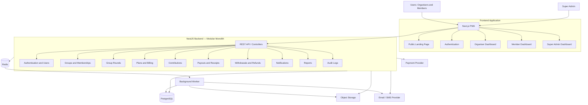
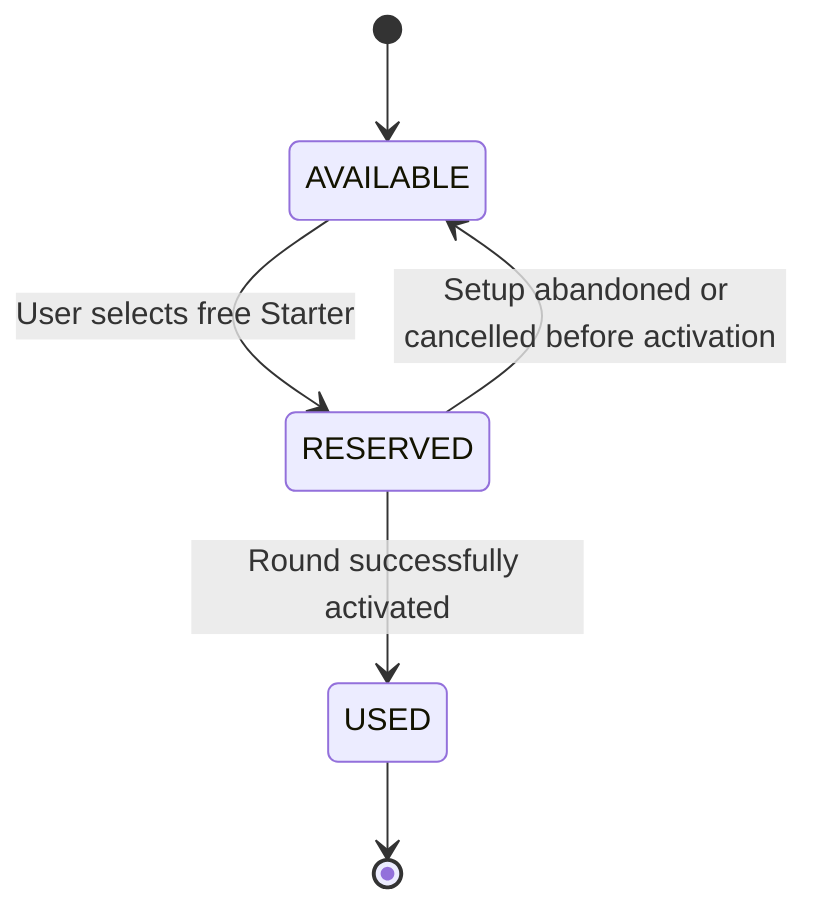
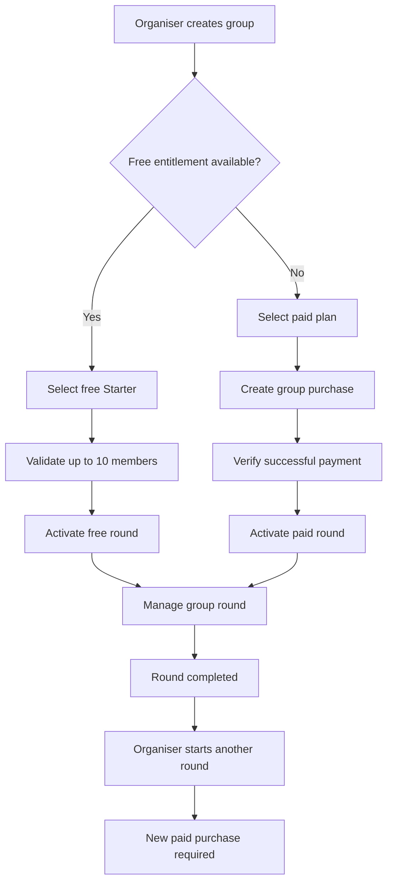
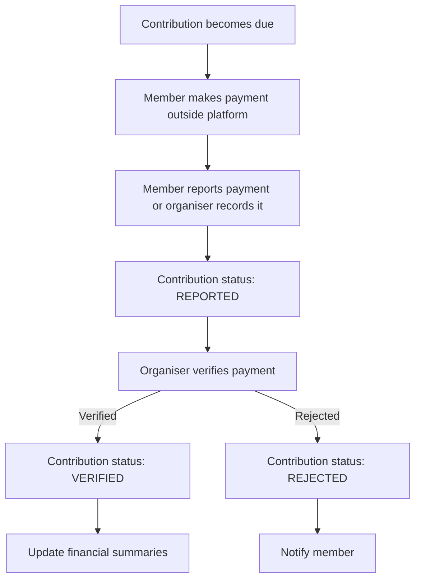
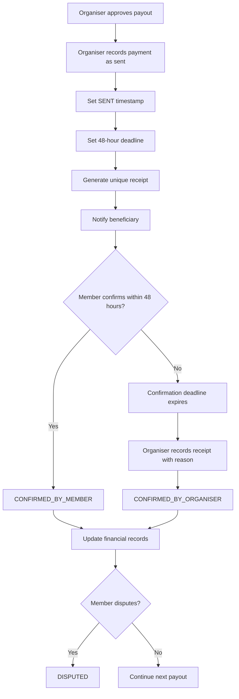

# Adashi Platform — System Architecture

**Document:** 03 — System Architecture  
**Product:** Adashi  
**Architecture Style:** Modular Monolith  
**Frontend:** Next.js  
**Backend:** NestJS  
**Database:** PostgreSQL  
**Currency:** NGN  
**Application Type:** Mobile-first Progressive Web Application (PWA)

---

# 1. Architecture Overview

## 1.1 Purpose

This document defines the technical architecture for the Adashi platform.

Adashi is a digital group contribution and savings management platform designed to help people organise, manage and monitor traditional Adashi arrangements.

The platform supports two major group types:

1. **Rotational Adashi:** Members contribute according to an agreed schedule, and each member receives the pooled contribution in an established order.
2. **Target-Based Adashi:** Members contribute towards a common savings target, and the accumulated distributable amount is shared equally among eligible members.

The architecture must support multiple groups, multiple group rounds, financial transparency, manual payment verification, automated notifications, receipt generation and future payment integrations.

## 1.2 Architecture principles

The platform should follow these principles:

- Modular and maintainable code.
- Clear separation between frontend and backend.
- Centralised authentication and authorisation.
- Group-level and round-level data isolation.
- Transaction-safe financial operations.
- Auditable financial records.
- Reliable background processing.
- Secure file storage.
- Mobile-first user experience.
- Scalable infrastructure.
- API-first development.
- Migration-managed database schema.

---

# 2. High-Level Architecture

Adashi will use a modular monolith with independently deployable frontend and backend applications.

The backend contains business modules within one NestJS application. These modules communicate through clearly defined service interfaces and domain events.

The frontend consumes the backend through REST APIs.



---

# 3. Recommended Technology Stack

## 3.1 Frontend

| Technology | Responsibility |
|---|---|
| Next.js | Main frontend framework |
| TypeScript | Type safety |
| Tailwind CSS | Styling |
| shadcn/ui | Reusable UI components |
| TanStack Query | API data fetching and caching |
| React Hook Form | Form handling |
| Zod | Form and client-side validation |
| Zustand | Lightweight client state |
| PWA support | Installable mobile experience |
| Recharts | Financial dashboards and charts |

The frontend should be responsive and optimised for mobile devices.

The platform should work well on common Android smartphones, since many users will access Adashi through mobile browsers.

### Frontend application areas

1. Public website.
2. Registration and authentication.
3. Organiser dashboard.
4. Member dashboard.
5. Group management.
6. Group round management.
7. Contribution management.
8. Payout management.
9. Receipt viewing and downloading.
10. Withdrawal and refund management.
11. Notifications.
12. Reports.
13. Super Admin dashboard.

### Frontend routing suggestion

```text
/
├── /about
├── /how-it-works
├── /pricing
├── /faq
├── /auth
│   ├── /register
│   ├── /login
│   ├── /forgot-password
│   └── /reset-password
├── /dashboard
├── /organiser
│   ├── /groups
│   ├── /groups/new
│   ├── /groups/[groupId]
│   ├── /groups/[groupId]/members
│   ├── /groups/[groupId]/rounds
│   ├── /rounds/[roundId]
│   ├── /contributions
│   ├── /payouts
│   ├── /withdrawals
│   ├── /reports
│   └── /billing
├── /member
│   ├── /groups
│   ├── /groups/[groupId]
│   ├── /contributions
│   ├── /payouts
│   ├── /receipts
│   └── /withdrawals
├── /notifications
├── /profile
└── /admin
    ├── /users
    ├── /groups
    ├── /plans
    ├── /purchases
    └── /audit-logs
```

A user may be an organiser in one group and a member in another. The frontend should therefore provide a unified dashboard that displays all the user's groups and makes it easy to switch between organiser and member views.

Do not use one permanent global role to determine every group permission.

## 3.2 Backend

| Technology | Responsibility |
|---|---|
| NestJS | Backend framework |
| TypeScript | Programming language |
| PostgreSQL | Relational database |
| TypeORM | ORM and database migrations |
| Redis | Cache and background job infrastructure |
| BullMQ | Background jobs |
| JWT | Authentication |
| Passport | Authentication strategies |
| class-validator | Request validation |
| class-transformer | DTO transformation |
| Swagger | API documentation |
| ExcelJS | Spreadsheet reports, if required |
| PDF generation library | Payout receipt generation |
| Object storage SDK | File and receipt storage |

The backend will be responsible for all business rules and financial calculations.

The frontend must never be trusted to determine:

- Whether a user has used their free entitlement.
- Whether a user can activate a paid group.
- Whether a contribution is verified.
- Whether a payout can be confirmed.
- Whether the 48-hour deadline has expired.
- Whether a round is financially completed.
- How much a member should receive.

These rules must be enforced on the backend.

---

# 4. Backend Modular Monolith Structure

The NestJS application should be divided into independent business modules.

Suggested structure:

```text
api/
├── src/
│   ├── main.ts
│   ├── app.module.ts
│   │
│   ├── common/
│   │   ├── decorators/
│   │   ├── guards/
│   │   ├── filters/
│   │   ├── interceptors/
│   │   ├── pipes/
│   │   ├── enums/
│   │   ├── interfaces/
│   │   ├── exceptions/
│   │   └── utils/
│   │
│   ├── config/
│   │   ├── database.config.ts
│   │   ├── redis.config.ts
│   │   ├── storage.config.ts
│   │   └── app.config.ts
│   │
│   ├── database/
│   │   ├── migrations/
│   │   ├── seeds/
│   │   └── data-source.ts
│   │
│   ├── auth/
│   ├── users/
│   ├── groups/
│   ├── memberships/
│   ├── group-rounds/
│   ├── plans/
│   ├── billing/
│   ├── entitlements/
│   ├── contributions/
│   ├── contribution-cycles/
│   ├── payouts/
│   ├── receipts/
│   ├── target-distributions/
│   ├── withdrawals/
│   ├── refunds/
│   ├── disputes/
│   ├── notifications/
│   ├── reports/
│   ├── audit-logs/
│   ├── storage/
│   │
│   ├── integrations/
│   │   ├── payments/
│   │   ├── email/
│   │   └── sms/
│   │
│   ├── jobs/
│   │   ├── queues/
│   │   ├── processors/
│   │   └── schedulers/
│   │
│   └── health/
│
├── test/
├── .env.example
├── package.json
└── tsconfig.json
```

Each business module should own its entities, DTOs, controllers, services, and module configuration.

Example:

```text
payouts/
├── dto/
│   ├── create-payout.dto.ts
│   ├── mark-payout-sent.dto.ts
│   ├── confirm-payout.dto.ts
│   └── dispute-payout.dto.ts
├── entities/
│   └── payout.entity.ts
├── enums/
│   └── payout-status.enum.ts
├── payouts.controller.ts
├── payouts.service.ts
├── payouts.module.ts
└── payouts.spec.ts
```

Avoid placing all business logic in controllers or a single general-purpose service.

---

# 5. Backend Module Responsibilities

## 5.1 Authentication and Users

Responsibilities:

- User registration.
- Login and logout.
- Password hashing.
- Password reset.
- Email and phone verification.
- JWT access and refresh tokens.
- User profile management.
- Session management.
- Account suspension.

Authentication identifies the user.

Authorisation determines what that user can do within a particular group.

## 5.2 Groups and Memberships

Responsibilities:

- Create groups.
- Edit group details.
- Generate group invitation codes.
- Invite members.
- Accept or reject invitations.
- Remove members.
- Manage group membership status.
- Configure group payment collection method.
- Enforce group ownership.

Only authorised organisers can manage their groups.

## 5.3 Group Rounds

Responsibilities:

- Create operational rounds.
- Configure round settings.
- Create round membership snapshots.
- Configure contribution schedules.
- Configure rotational payout order.
- Start and complete rounds.
- Create subsequent rounds.
- Preserve previous round history.

A group should not have multiple active rounds unless an explicitly supported business rule is introduced later.

## 5.4 Plans and Entitlements

Responsibilities:

- Retrieve available plans.
- Assign free Starter entitlement.
- Reserve and consume free entitlements.
- Enforce one-time free access.
- Check member limits.
- Calculate upgrades.
- Validate paid round eligibility.
- Manage plan changes.

The free entitlement must be enforced transactionally.

The backend must never allow a user to consume the same free entitlement twice through simultaneous requests.

## 5.5 Billing

Responsibilities:

- Create group purchases.
- Process one-time purchases.
- Verify payment-provider transactions.
- Record payment references.
- Process upgrades.
- Handle failed payments.
- Handle refunds of platform purchases where applicable.
- Maintain platform revenue reports.

Platform purchase payments must remain separate from group contributions.

## 5.6 Contributions

Responsibilities:

- Record expected contributions.
- Allow members to report payments.
- Allow organisers to record payments.
- Verify contributions.
- Reject reported payments.
- Reverse incorrect records.
- Track overdue contributions.
- Calculate member contribution summaries.

## 5.7 Payouts

Responsibilities:

- Manage beneficiary order.
- Create payout obligations.
- Approve payouts.
- Mark payouts as sent.
- Record transaction references.
- Start the 48-hour confirmation period.
- Accept member confirmations.
- Allow organiser confirmation after 48 hours.
- Manage payout disputes.
- Notify relevant users.

## 5.8 Receipts

Responsibilities:

- Generate a unique receipt number.
- Generate PDF receipts.
- Store receipt files.
- Allow authorised receipt downloads.
- Preserve receipt versions.
- Display the current payout confirmation status.

Receipt generation should be triggered after a payout is successfully recorded as sent.

A background job can generate and store the PDF. The payout record must not be rolled back merely because PDF generation temporarily fails.

## 5.9 Target Distributions

Responsibilities:

- Calculate the distributable amount.
- Identify eligible members.
- Calculate equal shares.
- Handle rounding.
- Obtain organiser approval.
- Create payout obligations for each member.
- Track distribution completion.

The same payout and receipt workflow should be reused for target-based distributions.

## 5.10 Withdrawals and Refunds

Responsibilities:

- Receive withdrawal requests.
- Calculate settlement proposals.
- Review requests.
- Approve or reject requests.
- Create refund obligations.
- Record refunds sent.
- Track refund confirmation.
- Update membership and round participation status.

## 5.11 Notifications

Responsibilities:

- In-app notifications.
- Email notifications.
- SMS integration later.
- Contribution notifications.
- Payout notifications.
- 48-hour confirmation reminders.
- Withdrawal updates.
- Group round completion notifications.

## 5.12 Reports

Responsibilities:

- Member contribution summaries.
- Organiser financial summaries.
- Group contribution reports.
- Payout history.
- Outstanding contributions.
- Outstanding payouts.
- Refund reports.
- Group-round completion reports.
- Platform revenue reports.

## 5.13 Audit Logs

Responsibilities:

- Record sensitive actions.
- Preserve previous and new values.
- Track actors.
- Record timestamps.
- Support administrative investigations.
- Provide group financial accountability.

---

# 6. Authentication and Authorisation Architecture

## 6.1 Authentication

Use JWT authentication with:

- Short-lived access tokens.
- Rotating refresh tokens.
- Hashed refresh-token storage.
- Session revocation.
- Secure password hashing using Argon2id or bcrypt with appropriate configuration.

For browser authentication, prefer secure, HttpOnly, Secure and SameSite cookies for refresh-token handling.

Do not expose refresh tokens to browser JavaScript.

## 6.2 Group-level authorisation

Permissions must be checked against the group and round involved in each request.

Example:

An authenticated user requests:

`GET /api/v1/groups/:groupId/financial-summary`

The backend must:

1. Authenticate the user.
2. Load the requested group.
3. Confirm that the user belongs to that group.
4. Determine their membership role.
5. Apply the appropriate permissions.
6. Return only authorised information.

Never trust a `userId`, `groupId`, `role` or `organiserId` supplied by the frontend without validating it against the authenticated user and database.

## 6.3 Example permissions

| Action | Organiser | Member |
|---|---|---|
| View group details | Yes | Yes |
| Invite members | Yes | No |
| Configure contribution schedule | Yes | No |
| View own contributions | Yes | Yes |
| View all member contributions | Yes | No by default |
| Report a contribution | Yes | Yes |
| Verify contributions | Yes | No |
| Approve payouts | Yes | No |
| Mark payout as sent | Yes | No |
| Confirm payout received | No | Yes, as beneficiary |
| Organiser payout override | Yes, after 48 hours | No |
| Dispute a payout | No, unless beneficiary | Yes, as beneficiary |
| Request withdrawal | No | Yes |
| Review withdrawal | Yes | No |
| View group reports | Yes | Limited |
| View personal financial history | Yes | Yes |

A user may have different permissions in different groups.

---

# 7. Free Starter Access and Billing Architecture

The platform must support one free Starter round per user account.

## 7.1 Free entitlement lifecycle



The `USED` state must be permanent for that entitlement.

## 7.2 Free Starter rules

- One free Starter entitlement per user account.
- Maximum of 10 members.
- No monthly or annual recurring billing.
- No free entitlement reset after group completion.
- No reset after group deletion.
- No transfer between accounts.
- Paid plans are required for subsequent rounds.
- The free round must have the same core functionality as a paid Starter round.

## 7.3 Paid group round lifecycle



A completed free Starter round does not grant another free round.

## 7.4 Upgrade architecture

If the organiser exceeds the current plan's member limit:

1. The backend validates the requested member count.
2. The backend retrieves the applicable plan prices.
3. It calculates the upgrade difference.
4. It creates a pending upgrade purchase.
5. Payment is verified.
6. The plan limit is updated.
7. The action is audited.

For the free Starter round, an upgrade to a larger plan requires payment of the applicable upgrade amount. The free entitlement remains consumed.

---

# 8. Contribution and Payout Architecture

## 8.1 Contribution flow



For MVP, the platform records and verifies payments but does not hold group funds.

## 8.2 Payout flow



An organiser override must not silently erase the fact that the member did not personally confirm receipt.

A member dispute must remain visible and auditable.

## 8.3 Receipt generation

Receipt generation should be handled through a background job.

The payout transaction creates the receipt record and an outbox/job record reliably.

The worker then:

1. Retrieves the payout and beneficiary information.
2. Generates the PDF.
3. Uploads the PDF to secure object storage.
4. Updates the receipt file location.
5. Notifies the organiser and beneficiary that the receipt is available.

The receipt should be accessible through authorised API endpoints rather than exposing public storage URLs.

---

# 9. Background Jobs and Scheduling

Adashi needs background processing for activities that should not depend on a user being online.

Use Redis and BullMQ.

Recommended queues:

| Queue | Responsibility |
|---|---|
| notification-queue | In-app, email and SMS notifications |
| receipt-queue | PDF receipt generation |
| payout-deadline-queue | 48-hour confirmation deadlines |
| contribution-reminder-queue | Upcoming and overdue contributions |
| billing-queue | Payment verification and billing events |
| report-queue | Large report generation |
| audit-queue | Reliable asynchronous audit delivery, where appropriate |

## 9.1 48-hour deadline processing

When a payout is marked as sent:

- Save the sent timestamp.
- Calculate the deadline as 48 elapsed hours later.
- Enqueue a reminder and deadline job.
- Notify the beneficiary.

A scheduled worker should also periodically find payouts whose confirmation deadlines have expired but remain in `SENT` status.

This reconciliation process is important because queued jobs can fail, be delayed or be lost during infrastructure incidents.

The worker should use idempotent processing so that the same reminder or deadline event cannot produce duplicate actions.

The deadline worker must not automatically mark a payout as received. Only the beneficiary or an authorised organiser can perform that confirmation action.

---

# 10. Notifications Architecture

The MVP should include in-app notifications.

Email can be included where an email provider is configured. SMS can be introduced as an additional channel.

## Notification channels

| Channel | MVP priority |
|---|---|
| In-app | Required |
| Email | Recommended |
| SMS | Later phase |
| Push notifications | Later phase |

## Notification events

- Group invitation.
- Group membership acceptance.
- Contribution due.
- Contribution reported.
- Contribution verified.
- Contribution rejected.
- Payout approved.
- Payout marked as sent.
- Receipt generated.
- Payout confirmation reminder.
- Confirmation deadline expired.
- Organiser confirmation.
- Payout dispute.
- Withdrawal request.
- Withdrawal decision.
- Refund recorded.
- Group round completion.
- Group plan upgrade.

Do not put sensitive financial details in SMS or email messages unnecessarily. Use authenticated in-app pages for full transaction details.

---

# 11. File and Receipt Storage

Use an object storage provider for:

- Payout receipt PDFs.
- Contribution evidence.
- Refund evidence.
- User profile images.
- Other approved attachments.

The storage layer should be abstracted behind a storage service so the provider can be changed later.

Suggested storage structure:

```text
adashi/
├── profile-images/
├── contribution-evidence/
├── payout-receipts/
│   └── {groupId}/
│       └── {roundId}/
├── refund-evidence/
└── dispute-evidence/
```

Use private storage for financial evidence and receipts.

Generate time-limited signed URLs or serve files through authorised backend endpoints.

Do not expose permanent public links to private transaction evidence.

---

# 12. Payment Integration Architecture

## 12.1 MVP payment model

The MVP should not operate an internal wallet or hold members' savings.

Members transfer money directly to:

- The organiser's bank account; or
- The current beneficiary's bank account.

The organiser records and verifies the payment within Adashi.

The platform separately collects its own group purchase fees.

## 12.2 Platform purchase payments

Use a payment integration abstraction.

Suggested structure:

```text
integrations/
└── payments/
    ├── interfaces/
    │   └── payment-provider.interface.ts
    ├── providers/
    │   ├── paystack.provider.ts
    │   └── flutterwave.provider.ts
    ├── payments.service.ts
    ├── payments.module.ts
    └── webhooks/
```

The actual provider should be selected after commercial, availability and regulatory review.

Payment verification must occur server-side.

Validate:

- Provider transaction reference.
- Expected amount.
- Currency.
- Transaction status.
- Purchase ownership.
- Duplicate webhook delivery.

Webhook processing must be idempotent.

## 12.3 Future automated collections

Future versions may support:

- Direct member-to-group payment links.
- Automated contribution collection.
- Bank transfer matching.
- Automated payout initiation.
- Provider reconciliation.

These features require appropriate provider support and legal/regulatory review before implementation.

---

# 13. Reporting Architecture

Reporting should be based on financial transaction records.

Recommended reporting services:

- Member financial summary.
- Organiser group summary.
- Contribution collection report.
- Outstanding contribution report.
- Payout history.
- Outstanding payout report.
- Withdrawal and refund report.
- Target distribution report.
- Group round completion report.
- Platform revenue report.

For the MVP, use indexed SQL queries and database views where appropriate.

Introduce materialized views or reporting tables only when performance measurements justify them.

Never use a manually maintained dashboard total as the source of financial truth.

---

# 14. API Architecture

Use REST APIs with versioning.

Base URL:

```text
/api/v1
```

Suggested API groups:

```text
/api/v1/auth
/api/v1/users
/api/v1/groups
/api/v1/memberships
/api/v1/group-rounds
/api/v1/plans
/api/v1/entitlements
/api/v1/billing
/api/v1/contributions
/api/v1/contribution-cycles
/api/v1/payouts
/api/v1/receipts
/api/v1/target-distributions
/api/v1/withdrawals
/api/v1/refunds
/api/v1/disputes
/api/v1/notifications
/api/v1/reports
/api/v1/admin
/api/v1/webhooks
```

All endpoints must enforce authentication and resource-level authorisation where required.

Swagger should document request DTOs, responses, authentication requirements, roles and error responses.

---

# 15. Security Architecture

Security is especially important because Adashi manages sensitive group financial records.

Implement:

1. Password hashing.
2. JWT access and refresh token security.
3. Secure cookies for browser sessions.
4. Group-level resource authorisation.
5. DTO validation.
6. Rate limiting.
7. Login throttling.
8. CORS restrictions.
9. Secure HTTP headers.
10. Database least-privilege access.
11. Private file storage.
12. Audit logging.
13. Payment webhook signature verification.
14. Transaction-safe financial operations.
15. Protection against duplicate submissions.
16. Input sanitisation and output encoding.
17. Secrets management through deployment environment variables.
18. Database backups and recovery procedures.

Do not log passwords, tokens, bank credentials or sensitive payment information.

## Financial transaction integrity

Use PostgreSQL transactions for operations involving:

- Free entitlement consumption.
- Group activation.
- Group purchase activation.
- Contribution verification.
- Payout status changes.
- Target distribution creation.
- Refund approval and settlement.

Use row locking and unique constraints to protect against concurrent requests.

Financial operations must be idempotent where possible.

---

# 16. Infrastructure and Deployment

## 16.1 Recommended deployment components

| Component | Recommended responsibility |
|---|---|
| Vercel or equivalent | Next.js frontend |
| Managed Node.js hosting | NestJS API |
| Managed PostgreSQL | Main database |
| Managed Redis | Background job queues |
| Object storage | Receipts and evidence |
| Email provider | Email notifications |
| SMS provider | Optional SMS |
| Monitoring service | Application health and errors |

For the initial MVP, a managed hosting setup is preferable to maintaining servers manually.

Choose hosting based on reliability, backups, regional performance, pricing and ability to scale.

## 16.2 Deployment separation

The frontend and backend should be independently deployable.

Suggested repositories:

```text
adashi-web/
adashi-api/
```

The frontend communicates with the backend through a configured API base URL.

The backend connects to PostgreSQL and Redis through private credentials and environment variables.

The background worker should run as a separate process using the same backend codebase and queue infrastructure.

## 16.3 Environment separation

Maintain:

- Local development.
- Staging.
- Production.

Do not use production financial records for ordinary development tests.

Use separate databases and payment-provider credentials for each environment.

---

# 17. Performance and Scalability

The initial implementation should be simple but ready to scale.

### Database

- Add indexes to frequently queried columns.
- Use pagination.
- Avoid loading entire group histories at once.
- Use appropriate connection pooling.
- Monitor slow queries.
- Use transactions only around the operations that require them.

### Backend

- Keep controllers thin.
- Use asynchronous jobs for slow operations.
- Cache safe, non-sensitive reference data.
- Avoid caching financial balances without reliable invalidation.
- Use structured logging.
- Measure performance before introducing complex infrastructure.

### Frontend

- Use server rendering for public pages where useful.
- Use pagination and query caching for dashboards.
- Optimise images.
- Lazy-load large reports.
- Avoid unnecessarily refetching financial data.
- Keep mobile bundle sizes small.

### Future scaling

If user activity increases significantly:

1. Scale API instances horizontally.
2. Scale background workers independently.
3. Increase database resources.
4. Introduce read replicas for reporting if justified.
5. Move large reporting workloads away from transactional queries.
6. Separate high-load modules into services only when a clear operational reason exists.

Do not introduce microservices prematurely.

---

# 18. Observability and Reliability

The platform should include:

- Application health endpoints.
- Database connectivity checks.
- Redis connectivity checks.
- Structured application logs.
- Error tracking.
- Background job failure monitoring.
- Payment webhook monitoring.
- Receipt generation failure monitoring.
- Database backup monitoring.
- Uptime monitoring.

Recommended health endpoints:

```text
GET /api/v1/health
GET /api/v1/health/database
GET /api/v1/health/redis
```

Important operational alerts:

- Database unavailable.
- Redis unavailable.
- Repeated background job failures.
- Payment verification failures.
- Receipt generation failures.
- Unprocessed payout deadline events.
- Repeated payment webhook failures.

Use a dead-letter or failed-job review process for jobs that cannot be completed after configured retries.

---

# 19. Testing Architecture

Testing should cover the financial and access-control rules, not only ordinary CRUD operations.

## Unit tests

Test:

- Free entitlement eligibility.
- Group plan limits.
- Upgrade calculations.
- Contribution validation.
- Payout confirmation.
- 48-hour deadline calculations.
- Organiser override eligibility.
- Target distribution calculations.
- Withdrawal settlement calculations.
- Round completion rules.

## Integration tests

Test:

- Database transactions.
- Concurrent free entitlement requests.
- Concurrent payout confirmation requests.
- Contribution verification.
- Receipt generation.
- Payment webhook idempotency.
- Notification delivery.
- Group-level access control.

## End-to-end tests

Test complete user journeys:

1. User registers.
2. User receives one free Starter entitlement.
3. User creates a free Starter group.
4. User invites members.
5. Members join.
6. Organiser activates the round.
7. Members report contributions.
8. Organiser verifies contributions.
9. Organiser records a payout as sent.
10. Receipt is generated.
11. Member receives notification.
12. Member confirms receipt.
13. Organiser starts the next beneficiary payout.
14. Round completes after all obligations are settled.
15. Organiser starts a new round and is required to pay.

Also test the no-confirmation journey:

1. Organiser marks payout as sent.
2. Member does not respond.
3. 48 hours elapse.
4. Organiser records receipt with a reason.
5. Member is notified.
6. Member raises a dispute.
7. The system preserves the financial history and prevents false round completion.

---

# 20. Implementation Phases

## Phase 1 — Foundation

- Repository setup.
- Next.js application.
- NestJS application.
- PostgreSQL connection.
- TypeORM migrations.
- Authentication.
- User profiles.
- Swagger.
- Basic responsive layout.

## Phase 2 — Groups and Free Access

- Group creation.
- Membership management.
- Invitation flow.
- Group configuration.
- Plan management.
- One-time free Starter entitlement.
- Entitlement reservation and consumption.
- Group-round creation.

## Phase 3 — Contributions

- Contribution schedules.
- Contribution reporting.
- Manual contribution recording.
- Verification and rejection.
- Member financial summary.
- Organiser financial summary.

## Phase 4 — Payouts and Receipts

- Beneficiary order.
- Payout approval.
- Mark payout as sent.
- 48-hour confirmation deadline.
- Member confirmation.
- Organiser override.
- Disputes.
- Automatic receipt generation.
- Receipt PDF download.

## Phase 5 — Target-Based Adashi

- Savings target configuration.
- Target progress.
- Eligible member calculation.
- Equal distribution.
- Rounding.
- Distribution approval.
- Payout creation.

## Phase 6 — Withdrawals and Refunds

- Withdrawal requests.
- Organiser review.
- Settlement calculations.
- Refund recording.
- Withdrawal history.

## Phase 7 — Billing and Notifications

- Paid group purchases.
- Payment provider integration.
- Plan upgrades.
- In-app notifications.
- Email notifications.
- Background jobs.

## Phase 8 — Reports and Administration

- Financial reports.
- Platform revenue.
- Super Admin dashboard.
- Audit log review.
- Operational monitoring.

## Phase 9 — Testing and Launch

- Security testing.
- Financial integrity testing.
- Performance testing.
- User acceptance testing.
- Pilot deployment.
- Production monitoring.

---

# 21. Architecture Decisions

The following decisions are the recommended baseline for implementation.

| Area | Decision |
|---|---|
| Architecture | Modular monolith |
| Frontend | Next.js + TypeScript |
| Backend | NestJS + TypeScript |
| Database | PostgreSQL |
| ORM | TypeORM |
| API style | REST |
| API version | `/api/v1` |
| Authentication | JWT with secure refresh-token handling |
| Background jobs | BullMQ + Redis |
| File storage | Private object storage |
| Receipts | PDF generation |
| Currency | NGN |
| Group types | Rotational and Target-Based |
| Billing | One-time per group round |
| Free access | One-time Starter entitlement per user |
| Contribution verification | Manual MVP workflow |
| Payout confirmation | Member confirmation |
| Confirmation period | 48 elapsed hours |
| Organiser override | Allowed after deadline with reason |
| Financial history | Auditable and retained |
| Deployment | Separate frontend, API and worker processes |
| Scaling strategy | Scale modular monolith before considering service extraction |

---

# 22. Final Architecture Recommendation

Adashi should start as a well-structured modular monolith with Next.js, NestJS, PostgreSQL, Redis and BullMQ.

This approach provides:

- Faster MVP development.
- Clear module ownership.
- Reliable financial transactions.
- Independent background processing.
- Easier testing.
- Lower infrastructure complexity.
- A practical path to future growth.

The most important architectural priority is financial integrity.

Every contribution, payout, refund, receipt and group purchase must be traceable to the user, group and round involved.

The one-time free Starter entitlement must be enforced by the backend and database.

The 48-hour payout confirmation workflow must be processed reliably through background jobs.

The platform should not hold members' savings or operate an internal wallet in the MVP.

**The architecture is designed to support a single pilot group initially while allowing Adashi to grow into a multi-group, multi-organiser platform without requiring a complete rewrite.**