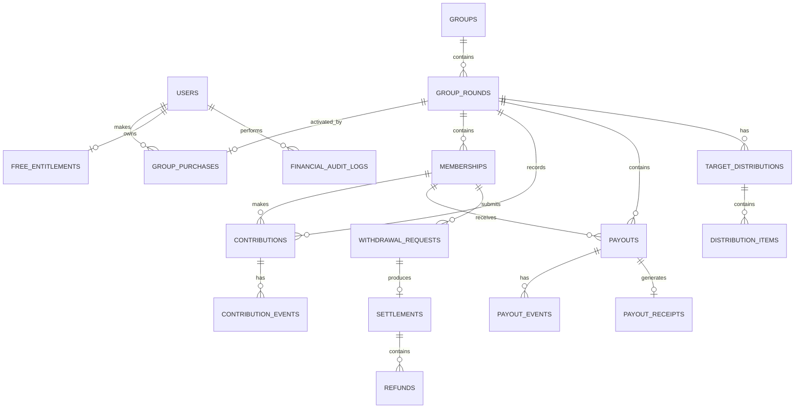

# 09 — Financial Data Model and Transaction Ledger Design

## 1. Document Purpose

This document defines the database design for the Adashi platform's financial operations.

It translates the requirements in Document 08 — Payment, Billing and Financial Operations Specification — into a structured data model suitable for implementation with:

- PostgreSQL
- NestJS
- TypeORM
- Redis and BullMQ for background processing
- Private object storage for payment evidence and generated receipts

The design covers:

1. Group purchase billing.
2. Free Starter entitlements.
3. Plan upgrades.
4. Contributions.
5. Contribution verification and reversals.
6. Payout obligations and confirmations.
7. Payout receipts.
8. Target-based distributions.
9. Withdrawals and settlements.
10. Refunds.
11. Financial audit records.
12. Financial reporting and reconciliation.

The database must preserve financial history and prevent duplicate or unauthorised financial operations.

---

## 2. Database Design Principles

### 2.1 Financial records are authoritative

The database records the history of financial events. Financial balances and summaries must be calculated from valid financial records.

Do not use a manually editable balance as the source of truth.

### 2.2 Preserve historical records

Financial records must not be physically deleted through normal application operations.

Corrections should create reversal or adjustment records linked to the original transaction.

### 2.3 Separate financial domains

Keep these categories separate:

- Platform billing.
- Group contributions.
- Beneficiary payouts.
- Withdrawals and refunds.

A group purchase payment must never be included in a group's contribution total.

### 2.4 Round-level isolation

Every contribution, payout, distribution, and withdrawal must reference its relevant group round.

This allows a persistent group to run multiple independent rounds without mixing historical financial activity.

### 2.5 Use database-level integrity

Enforce important rules using:

- Foreign keys.
- Unique constraints.
- Check constraints.
- Transactions.
- Row-level locks.
- Appropriate indexes.

Application-level validation alone is insufficient for critical financial operations.

---

## 3. Entity Relationship Overview

The following is the proposed financial relationship structure.



The diagram is conceptual. Actual database foreign keys should be implemented with appropriate ownership and integrity rules.

---

## 4. Money Representation

All monetary amounts must use one consistent representation.

Recommended PostgreSQL representation:

```sql
NUMERIC(18, 2)
```

Examples:

| Amount | Stored value |
|---|---:|
| ₦1,000 | 1000.00 |
| ₦1,500.50 | 1500.50 |
| ₦45,000 | 45000.00 |

PostgreSQL `NUMERIC` values should be handled as strings or decimal-library values in TypeScript.

Do not convert financial values to JavaScript floating-point numbers for calculations.

Recommended TypeScript handling:

```typescript
type Money = string;
```

For calculations, use a decimal arithmetic library and validate the result before persisting it.

Every financial record should also store a currency code:

```text
NGN
```

This makes future multi-currency support easier without requiring a redesign.

---

## 5. Core Financial Entities

### 5.1 Group purchase plans

Table: `billing_plans`

Stores available group activation plans.

| Column | Type | Description |
|---|---|---|
| id | UUID | Primary key |
| name | VARCHAR(100) | Plan name |
| code | VARCHAR(50) | Unique plan code |
| description | TEXT | Plan description |
| member_limit | INTEGER | Maximum permitted members |
| price | NUMERIC(18,2) | Current plan price |
| currency | VARCHAR(3) | NGN |
| is_active | BOOLEAN | Whether plan can be purchased |
| created_at | TIMESTAMPTZ | Creation timestamp |
| updated_at | TIMESTAMPTZ | Last update |

Suggested plan codes:

- `STARTER`
- `STANDARD`
- `PREMIUM`
- `ENTERPRISE`

Plan prices must be configurable.

Do not overwrite historical purchase amounts when the plan price changes.

### 5.2 Group purchases

Table: `group_purchases`

Records one-time purchases for group rounds and upgrades.

| Column | Type | Description |
|---|---|---|
| id | UUID | Primary key |
| user_id | UUID | Organiser who purchased |
| group_id | UUID | Related group |
| group_round_id | UUID | Related round |
| billing_plan_id | UUID | Selected plan |
| purchase_type | ENUM | INITIAL_ACTIVATION or UPGRADE |
| previous_plan_id | UUID, nullable | Previous plan for upgrades |
| amount_due | NUMERIC(18,2) | Amount payable |
| amount_paid | NUMERIC(18,2) | Amount received |
| currency | VARCHAR(3) | NGN |
| status | ENUM | Purchase status |
| payment_reference | VARCHAR(150), nullable | Payment reference |
| paid_at | TIMESTAMPTZ, nullable | Payment timestamp |
| verified_by | UUID, nullable | Platform administrator |
| verified_at | TIMESTAMPTZ, nullable | Verification timestamp |
| idempotency_key | VARCHAR(150) | Request deduplication |
| created_at | TIMESTAMPTZ | Creation timestamp |
| updated_at | TIMESTAMPTZ | Last update |

Suggested statuses:

```text
PENDING
PAYMENT_REPORTED
PAID
FAILED
CANCELLED
REFUNDED
```

Important constraints:

- A purchase must belong to one organiser, group, and round.
- A purchase must preserve the plan and amount selected at creation.
- An idempotency key must be unique within its appropriate scope.
- A purchase cannot activate a round more than once.

For upgrades, retain the previous plan and record the additional amount charged.

### 5.3 Group purchase payment records

Table: `group_purchase_payments`

Separates individual payment attempts from the purchase itself.

| Column | Type | Description |
|---|---|---|
| id | UUID | Primary key |
| group_purchase_id | UUID | Related purchase |
| amount | NUMERIC(18,2) | Amount reported or received |
| currency | VARCHAR(3) | NGN |
| payment_method | VARCHAR(50) | Transfer, gateway, etc. |
| payment_reference | VARCHAR(150), nullable | External reference |
| evidence_file_key | TEXT, nullable | Private storage key |
| status | ENUM | Payment attempt status |
| reported_by | UUID | User who reported payment |
| verified_by | UUID, nullable | Verifying administrator |
| verified_at | TIMESTAMPTZ, nullable | Verification time |
| rejection_reason | TEXT, nullable | Reason for rejection |
| created_at | TIMESTAMPTZ | Creation timestamp |

A single purchase may have multiple payment attempts, but only valid verified payments should contribute to the amount paid.

Prevent duplicate provider transaction references where a provider supplies a unique reference.

---

## 6. Free Starter Entitlement

### 6.1 Entitlements table

Table: `free_entitlements`

| Column | Type | Description |
|---|---|---|
| id | UUID | Primary key |
| user_id | UUID | Entitlement owner |
| status | ENUM | AVAILABLE, RESERVED, USED |
| reserved_group_id | UUID, nullable | Group being activated |
| reserved_round_id | UUID, nullable | Round being activated |
| reserved_at | TIMESTAMPTZ, nullable | Reservation timestamp |
| reservation_expires_at | TIMESTAMPTZ, nullable | Reservation expiry |
| used_at | TIMESTAMPTZ, nullable | Consumption timestamp |
| created_at | TIMESTAMPTZ | Creation timestamp |
| updated_at | TIMESTAMPTZ | Last update |

Database constraint:

```sql
CREATE UNIQUE INDEX uq_free_entitlement_user
ON free_entitlements(user_id);
```

This ensures one entitlement record per user.

### 6.2 Entitlement history

Table: `free_entitlement_events`

Records:
- Entitlement reserved.
- Reservation released.
- Entitlement consumed.
- Activation failure.
- Administrative correction.

Do not rely only on the current entitlement status to understand its history.

### 6.3 Entitlement activation transaction

The activation operation should:

1. Lock the entitlement row.
2. Verify that it is available or has a valid reservation.
3. Verify that the user owns the group.
4. Verify that the group round is eligible.
5. Activate the round.
6. Change entitlement status to `USED`.
7. Record the entitlement event.
8. Commit the transaction.

If any critical step fails, roll back the transaction.

A successfully consumed entitlement must not be restored through ordinary group deletion or round cancellation.

---

## 7. Contribution Data Model

### 7.1 Contributions

Table: `contributions`

Each record represents one expected or reported member contribution.

| Column | Type | Description |
|---|---|---|
| id | UUID | Primary key |
| group_id | UUID | Related group |
| group_round_id | UUID | Related round |
| membership_id | UUID | Member responsible |
| schedule_item_id | UUID, nullable | Related expected contribution/cycle |
| contribution_type | ENUM | ROTATIONAL or TARGET_BASED |
| amount_expected | NUMERIC(18,2) | Expected contribution |
| amount_reported | NUMERIC(18,2), nullable | Amount reported |
| amount_verified | NUMERIC(18,2), nullable | Amount verified |
| currency | VARCHAR(3) | NGN |
| status | ENUM | Contribution status |
| due_at | TIMESTAMPTZ, nullable | Due timestamp |
| reported_at | TIMESTAMPTZ, nullable | Report timestamp |
| verified_at | TIMESTAMPTZ, nullable | Verification timestamp |
| verified_by | UUID, nullable | Organiser who verified |
| rejected_at | TIMESTAMPTZ, nullable | Rejection timestamp |
| rejection_reason | TEXT, nullable | Rejection reason |
| created_at | TIMESTAMPTZ | Creation timestamp |
| updated_at | TIMESTAMPTZ | Last update |

Suggested statuses:

```text
EXPECTED
REPORTED
VERIFIED
REJECTED
OVERDUE
REVERSED
```

A contribution should be linked to a membership rather than directly to a global user role.

This allows the same user to participate in multiple groups.

### 7.2 Contribution events

Table: `contribution_events`

Stores contribution status history.

| Column | Type | Description |
|---|---|---|
| id | UUID | Primary key |
| contribution_id | UUID | Related contribution |
| actor_user_id | UUID | User performing action |
| previous_status | VARCHAR(30) | Previous status |
| new_status | VARCHAR(30) | New status |
| action | VARCHAR(50) | Action performed |
| reason | TEXT, nullable | Reason |
| metadata | JSONB, nullable | Additional details |
| created_at | TIMESTAMPTZ | Event timestamp |

### 7.3 Contribution evidence

Table: `contribution_evidence`

| Column | Type | Description |
|---|---|---|
| id | UUID | Primary key |
| contribution_id | UUID | Related contribution |
| uploaded_by | UUID | Uploading user |
| file_key | TEXT | Private object storage key |
| original_filename | VARCHAR(255) | Original filename |
| mime_type | VARCHAR(100) | File type |
| file_size | BIGINT | File size |
| created_at | TIMESTAMPTZ | Upload timestamp |

Evidence files should be stored outside PostgreSQL, with only metadata and private storage references saved in the database.

---

## 8. Payout Data Model

### 8.1 Payouts

Table: `payouts`

Each record represents a financial obligation to a beneficiary.

| Column | Type | Description |
|---|---|---|
| id | UUID | Primary key |
| group_id | UUID | Related group |
| group_round_id | UUID | Related round |
| membership_id | UUID | Beneficiary membership |
| cycle_id | UUID, nullable | Rotational cycle |
| distribution_id | UUID, nullable | Target distribution |
| payout_type | ENUM | ROTATIONAL, TARGET_DISTRIBUTION, REFUND |
| amount_expected | NUMERIC(18,2) | Approved obligation |
| amount_sent | NUMERIC(18,2), nullable | Amount marked sent |
| currency | VARCHAR(3) | NGN |
| status | ENUM | Payout status |
| sent_by | UUID, nullable | Organiser who marked sent |
| sent_at | TIMESTAMPTZ, nullable | Sent timestamp |
| payment_reference | VARCHAR(150), nullable | Payment reference |
| payment_method | VARCHAR(50), nullable | Payment channel |
| confirmation_deadline | TIMESTAMPTZ, nullable | 48-hour deadline |
| member_confirmed_at | TIMESTAMPTZ, nullable | Member confirmation time |
| organiser_confirmed_at | TIMESTAMPTZ, nullable | Organiser override time |
| organiser_confirmation_reason | TEXT, nullable | Override reason |
| cancelled_at | TIMESTAMPTZ, nullable | Cancellation time |
| created_at | TIMESTAMPTZ | Creation timestamp |
| updated_at | TIMESTAMPTZ | Last update |

Suggested statuses:

```text
PENDING
SENT
CONFIRMED_BY_MEMBER
CONFIRMED_BY_ORGANISER
DISPUTED
CANCELLED
```

The beneficiary is identified through the membership record.

### 8.2 Payout events

Table: `payout_events`

Records every payout state transition.

| Column | Type | Description |
|---|---|---|
| id | UUID | Primary key |
| payout_id | UUID | Related payout |
| actor_user_id | UUID | Actor |
| action | VARCHAR(50) | Action performed |
| previous_status | VARCHAR(40), nullable | Previous state |
| new_status | VARCHAR(40) | New state |
| reason | TEXT, nullable | Reason |
| evidence_file_key | TEXT, nullable | Supporting evidence |
| metadata | JSONB, nullable | Additional details |
| created_at | TIMESTAMPTZ | Event timestamp |

A payout event must be inserted whenever its status changes.

### 8.3 Payout disputes

Table: `payout_disputes`

| Column | Type | Description |
|---|---|---|
| id | UUID | Primary key |
| payout_id | UUID | Related payout |
| raised_by | UUID | Beneficiary |
| reason | TEXT | Dispute explanation |
| status | ENUM | OPEN, UNDER_REVIEW, RESOLVED, REJECTED |
| resolution | TEXT, nullable | Resolution details |
| resolved_by | UUID, nullable | Reviewer |
| resolved_at | TIMESTAMPTZ, nullable | Resolution timestamp |
| created_at | TIMESTAMPTZ | Creation timestamp |

A dispute should not delete or replace the original payout event history.

---

## 9. Payout Receipt Data Model

Table: `payout_receipts`

| Column | Type | Description |
|---|---|---|
| id | UUID | Primary key |
| payout_id | UUID | Related payout |
| receipt_number | VARCHAR(100) | Unique receipt number |
| generation_status | ENUM | Receipt generation state |
| file_key | TEXT, nullable | Generated PDF storage key |
| version | INTEGER | Receipt version |
| generated_at | TIMESTAMPTZ, nullable | Generation timestamp |
| failure_reason | TEXT, nullable | Generation error |
| created_at | TIMESTAMPTZ | Creation timestamp |
| updated_at | TIMESTAMPTZ | Last update |

Suggested generation states:

```text
GENERATING
AVAILABLE
FAILED
SUPERSEDED
```

Database constraints:

```sql
CREATE UNIQUE INDEX uq_payout_receipt_number
ON payout_receipts(receipt_number);

CREATE UNIQUE INDEX uq_payout_receipt_payout
ON payout_receipts(payout_id);
```

The unique payout constraint ensures that marking one payout as sent cannot create multiple initial receipts.

If receipt content must be corrected, create a new version or a controlled superseding record while retaining the original history.

Receipt creation must occur in the same transaction as the payout's transition to `SENT`.

PDF generation should happen asynchronously.

---

## 10. Target-Based Distribution Data Model

### 10.1 Target distributions

Table: `target_distributions`

| Column | Type | Description |
|---|---|---|
| id | UUID | Primary key |
| group_id | UUID | Related group |
| group_round_id | UUID | Related round |
| total_verified_contributions | NUMERIC(18,2) | Verified amount |
| approved_adjustments | NUMERIC(18,2) | Approved adjustments |
| distributable_amount | NUMERIC(18,2) | Amount to distribute |
| eligible_member_count | INTEGER | Eligible members |
| status | ENUM | Distribution status |
| approved_by | UUID, nullable | Approving organiser |
| approved_at | TIMESTAMPTZ, nullable | Approval time |
| created_at | TIMESTAMPTZ | Creation timestamp |

Suggested statuses:

```text
DRAFT
PENDING_APPROVAL
APPROVED
PROCESSING
COMPLETED
CANCELLED
```

### 10.2 Distribution items

Table: `distribution_items`

| Column | Type | Description |
|---|---|---|
| id | UUID | Primary key |
| distribution_id | UUID | Parent distribution |
| membership_id | UUID | Eligible member |
| amount | NUMERIC(18,2) | Member's equal share |
| payout_id | UUID, nullable | Created payout |
| created_at | TIMESTAMPTZ | Creation timestamp |

Database constraint:

```sql
CREATE UNIQUE INDEX uq_distribution_member
ON distribution_items(distribution_id, membership_id);
```

This prevents a member from receiving duplicate distribution items in one approved distribution.

### 10.3 Equal distribution and rounding

Calculate the distributable amount using decimal arithmetic.

For amounts represented in kobo, perform the division in integer minor units.

Example:

- Distributable amount: ₦10,000.00.
- Eligible members: 3.
- Total in kobo: 1,000,000.
- Base share: 333,333 kobo.
- Remainder: 1 kobo.

The system must apply a deterministic remainder allocation rule, such as assigning the remaining kobo to the first eligible membership in a stable, documented order.

The sum of all distribution items must always equal the distributable amount.

---

## 11. Withdrawal and Settlement Data Model

### 11.1 Withdrawal requests

Table: `withdrawal_requests`

| Column | Type | Description |
|---|---|---|
| id | UUID | Primary key |
| group_id | UUID | Related group |
| group_round_id | UUID | Related round |
| membership_id | UUID | Requesting membership |
| reason | TEXT | Withdrawal reason |
| status | ENUM | Withdrawal status |
| reviewed_by | UUID, nullable | Reviewing organiser |
| reviewed_at | TIMESTAMPTZ, nullable | Review timestamp |
| rejection_reason | TEXT, nullable | Rejection reason |
| created_at | TIMESTAMPTZ | Request timestamp |
| updated_at | TIMESTAMPTZ | Last update |

Suggested statuses:

```text
PENDING
APPROVED
REJECTED
SETTLEMENT_PENDING
SETTLED
CANCELLED
```

### 11.2 Settlements

Table: `settlements`

| Column | Type | Description |
|---|---|---|
| id | UUID | Primary key |
| withdrawal_request_id | UUID | Related request |
| membership_id | UUID | Member |
| verified_contributions | NUMERIC(18,2) | Valid contributions |
| previous_payouts | NUMERIC(18,2) | Payouts already received |
| outstanding_obligations | NUMERIC(18,2) | Valid outstanding obligations |
| previous_refunds | NUMERIC(18,2) | Refunds already made |
| settlement_amount | NUMERIC(18,2) | Calculated result |
| settlement_direction | ENUM | REFUND_DUE, AMOUNT_OWED, NO_BALANCE |
| status | ENUM | PENDING, APPROVED, SETTLED, CANCELLED |
| approved_by | UUID, nullable | Approving organiser |
| approved_at | TIMESTAMPTZ, nullable | Approval time |
| calculation_snapshot | JSONB | Inputs used in calculation |
| created_at | TIMESTAMPTZ | Creation timestamp |

The calculation snapshot preserves the financial inputs used to reach a settlement decision.

Do not use a generic formula that assumes every withdrawn member is entitled to a full refund. The settlement rules must differ appropriately between rotational and target-based groups.

### 11.3 Refunds

Table: `refunds`

| Column | Type | Description |
|---|---|---|
| id | UUID | Primary key |
| settlement_id | UUID | Related settlement |
| group_id | UUID | Related group |
| group_round_id | UUID | Related round |
| membership_id | UUID | Member receiving refund |
| amount | NUMERIC(18,2) | Approved refund |
| currency | VARCHAR(3) | NGN |
| status | ENUM | PENDING, SENT, CONFIRMED, CANCELLED |
| payment_reference | VARCHAR(150), nullable | Payment reference |
| sent_by | UUID, nullable | Organiser |
| sent_at | TIMESTAMPTZ, nullable | Sent timestamp |
| confirmed_at | TIMESTAMPTZ, nullable | Confirmation timestamp |
| created_at | TIMESTAMPTZ | Creation timestamp |

A refund is a separate financial record. It must not modify the original contribution.

---

## 12. Financial Audit Data Model

Table: `financial_audit_logs`

| Column | Type | Description |
|---|---|---|
| id | UUID | Primary key |
| actor_user_id | UUID, nullable | User performing action |
| group_id | UUID, nullable | Related group |
| group_round_id | UUID, nullable | Related round |
| entity_type | VARCHAR(80) | Financial entity |
| entity_id | UUID | Entity identifier |
| action | VARCHAR(100) | Action |
| previous_state | JSONB, nullable | Previous values |
| new_state | JSONB, nullable | New values |
| reason | TEXT, nullable | Reason |
| request_id | VARCHAR(150), nullable | Request correlation |
| created_at | TIMESTAMPTZ | Timestamp |

This table supplements the dedicated contribution and payout event tables.

For sensitive actions, both the domain event and the audit record should be written in the same database transaction.

Audit logs must not contain passwords, authentication tokens, or other secrets.

---

## 13. Optional Financial Ledger Extension

The initial MVP can calculate financial summaries from contributions, payouts, settlements, and refunds.

However, a more formal transaction ledger is recommended if the platform later introduces automated provider reconciliation or more advanced financial reporting.

A possible extension is:

### 13.1 Financial transactions

Table: `financial_transactions`

| Column | Type | Description |
|---|---|---|
| id | UUID | Primary key |
| group_id | UUID, nullable | Related group |
| group_round_id | UUID, nullable | Related round |
| transaction_type | VARCHAR(50) | Contribution, payout, refund, etc. |
| reference_type | VARCHAR(50) | Source entity type |
| reference_id | UUID | Source entity ID |
| amount | NUMERIC(18,2) | Transaction amount |
| currency | VARCHAR(3) | NGN |
| direction | VARCHAR(20) | INFLOW or OUTFLOW |
| status | VARCHAR(30) | Transaction status |
| occurred_at | TIMESTAMPTZ | Event timestamp |
| created_at | TIMESTAMPTZ | Record timestamp |

This table should be treated as an append-only reporting projection or event record, not as an editable account balance.

### 13.2 Double-entry accounting consideration

If the business later needs formal accounting ledgers, introduce:

- Ledger accounts.
- Journal entries.
- Journal entry lines.
- Debit and credit validation.
- Reconciliation against payment-provider settlement records.

Do not introduce a misleading internal wallet or imply custody of funds merely because a financial ledger exists.

The accounting design must reflect the platform's actual role and the applicable legal and regulatory requirements.

---

## 14. Database Constraints and Indexes

The following constraints are especially important.

### 14.1 Unique constraints

Enforce uniqueness for:

- Free entitlement per user.
- Receipt number.
- Initial receipt per payout.
- Distribution item per member and distribution.
- Provider payment reference where the provider guarantees uniqueness.
- Idempotency key within its defined scope.

### 14.2 Foreign key constraints

Use foreign keys for:
- Group ownership.
- Group rounds.
- Memberships.
- Contributions.
- Payouts.
- Receipts.
- Distributions.
- Settlements.
- Refunds.

Use `RESTRICT` or equivalent behaviour for financial records that must not be deleted while referenced.

Avoid cascading deletion from users, groups, or rounds into financial history.

### 14.3 Check constraints

Examples:

```sql
CHECK (amount_due >= 0)
```

```sql
CHECK (amount_paid >= 0)
```

```sql
CHECK (amount_expected >= 0)
```

```sql
CHECK (amount_sent >= 0)
```

```sql
CHECK (member_limit > 0)
```

For records where an amount must be strictly positive, use `> 0` instead.

### 14.4 Recommended indexes

```sql
CREATE INDEX idx_contributions_round_status
ON contributions(group_round_id, status);

CREATE INDEX idx_contributions_membership
ON contributions(membership_id, created_at DESC);

CREATE INDEX idx_payouts_round_status
ON payouts(group_round_id, status);

CREATE INDEX idx_payouts_membership
ON payouts(membership_id, created_at DESC);

CREATE INDEX idx_payouts_confirmation_deadline
ON payouts(confirmation_deadline)
WHERE status = 'SENT';

CREATE INDEX idx_purchase_user
ON group_purchases(user_id, created_at DESC);

CREATE INDEX idx_purchase_round
ON group_purchases(group_round_id);

CREATE INDEX idx_withdrawal_round_status
ON withdrawal_requests(group_round_id, status);

CREATE INDEX idx_financial_audit_entity
ON financial_audit_logs(entity_type, entity_id, created_at DESC);
```

Use indexes based on actual query patterns and confirm their usefulness with query plans as the application grows.

---

## 15. Critical Financial Transaction Workflows

### 15.1 Verify contribution

Within one database transaction:

1. Lock the contribution row.
2. Confirm the contribution is in `REPORTED` state.
3. Verify the organiser has permission for the group.
4. Validate the reported amount.
5. Set the verified amount.
6. Change status to `VERIFIED`.
7. Record the verifier and timestamp.
8. Insert a contribution event.
9. Insert a financial audit record.
10. Commit.

The notification should be dispatched through the transactional outbox after the database transaction commits.

### 15.2 Mark payout as sent

Within one database transaction:

1. Lock the payout row.
2. Verify organiser permission.
3. Confirm payout is eligible.
4. Confirm payout is not already sent.
5. Validate the sent amount.
6. Set status to `SENT`.
7. Record `sentAt` and `sentBy`.
8. Calculate `confirmationDeadline = sentAt + 48 hours`.
9. Create the unique receipt record.
10. Insert payout event.
11. Insert financial audit record.
12. Insert outbox event.
13. Commit.

Receipt PDF generation happens asynchronously.

### 15.3 Confirm payout as member

Within one database transaction:

1. Lock payout row.
2. Confirm authenticated user is the beneficiary.
3. Confirm payout status allows confirmation.
4. Change status to `CONFIRMED_BY_MEMBER`.
5. Record confirmation timestamp and actor.
6. Insert payout event.
7. Insert audit record.
8. Insert outbox event.
9. Commit.

### 15.4 Confirm payout on behalf

Within one database transaction:

1. Lock payout row.
2. Confirm organiser permission.
3. Confirm payout status is `SENT`.
4. Verify server time is at or after `confirmationDeadline`.
5. Require an override reason.
6. Change status to `CONFIRMED_BY_ORGANISER`.
7. Record organiser and timestamp.
8. Insert payout event.
9. Insert audit record.
10. Insert notification outbox event.
11. Commit.

If the beneficiary has already confirmed or disputed the payout, the override must not proceed.

### 15.5 Approve target distribution

Within one database transaction:

1. Lock the group round.
2. Confirm target requirements are met.
3. Retrieve verified contribution records.
4. Determine eligible memberships.
5. Check outstanding withdrawals and disputes.
6. Calculate distributable amount.
7. Calculate equal shares and remainder allocation.
8. Create the distribution record.
9. Create distribution items.
10. Create payout obligations.
11. Record organiser approval.
12. Insert audit and outbox events.
13. Commit.

The transaction must prevent two simultaneous distribution approvals for the same round.

---

## 16. NestJS Module and Entity Organisation

Recommended backend structure:

```text
src/
├── modules/
│   ├── billing/
│   │   ├── entities/
│   │   │   ├── billing-plan.entity.ts
│   │   │   ├── group-purchase.entity.ts
│   │   │   └── group-purchase-payment.entity.ts
│   │   ├── billing.controller.ts
│   │   ├── billing.service.ts
│   │   └── billing.module.ts
│   │
│   ├── entitlements/
│   │   ├── entities/
│   │   │   ├── free-entitlement.entity.ts
│   │   │   └── free-entitlement-event.entity.ts
│   │   ├── entitlements.controller.ts
│   │   ├── entitlements.service.ts
│   │   └── entitlements.module.ts
│   │
│   ├── contributions/
│   │   ├── entities/
│   │   │   ├── contribution.entity.ts
│   │   │   ├── contribution-event.entity.ts
│   │   │   └── contribution-evidence.entity.ts
│   │   ├── contributions.controller.ts
│   │   ├── contributions.service.ts
│   │   └── contributions.module.ts
│   │
│   ├── payouts/
│   │   ├── entities/
│   │   │   ├── payout.entity.ts
│   │   │   ├── payout-event.entity.ts
│   │   │   └── payout-dispute.entity.ts
│   │   ├── payouts.controller.ts
│   │   ├── payouts.service.ts
│   │   └── payouts.module.ts
│   │
│   ├── receipts/
│   │   ├── entities/
│   │   │   └── payout-receipt.entity.ts
│   │   ├── receipts.service.ts
│   │   ├── receipts.processor.ts
│   │   └── receipts.module.ts
│   │
│   ├── distributions/
│   │   ├── entities/
│   │   │   ├── target-distribution.entity.ts
│   │   │   └── distribution-item.entity.ts
│   │   ├── distributions.service.ts
│   │   └── distributions.module.ts
│   │
│   ├── withdrawals/
│   │   ├── entities/
│   │   │   ├── withdrawal-request.entity.ts
│   │   │   ├── settlement.entity.ts
│   │   │   └── refund.entity.ts
│   │   ├── withdrawals.service.ts
│   │   └── withdrawals.module.ts
│   │
│   └── financial-audit/
│       ├── entities/
│       │   └── financial-audit-log.entity.ts
│       ├── financial-audit.service.ts
│       └── financial-audit.module.ts
│
└── shared/
    ├── database/
    ├── money/
    ├── idempotency/
    └── outbox/
```

Keep modules responsible for their own business rules. Use explicit service interfaces or exported providers when one financial module needs another.

Avoid circular dependencies between billing, contributions, payouts, and receipts.

---

## 17. TypeORM Implementation Guidelines

### 17.1 Entity conventions

Use:
- UUID primary keys.
- Explicit table names.
- `timestamptz` for timestamps.
- `numeric` for money.
- PostgreSQL enums or carefully managed string columns.
- Explicit foreign key relationships.
- Database migrations.

### 17.2 Transaction management

Use TypeORM's `DataSource.transaction()` or a `QueryRunner` where explicit locking is needed.

Example:

```typescript
await this.dataSource.transaction(async (manager) => {
  const contribution = await manager
    .getRepository(Contribution)
    .createQueryBuilder('contribution')
    .setLock('pessimistic_write')
    .where('contribution.id = :id', { id: contributionId })
    .getOne();

  if (!contribution) {
    throw new NotFoundException('Contribution not found');
  }

  if (contribution.status !== ContributionStatus.REPORTED) {
    throw new ConflictException(
      'Contribution is not awaiting verification',
    );
  }

  contribution.status = ContributionStatus.VERIFIED;
  contribution.verifiedAt = new Date();
  contribution.verifiedBy = organiserId;

  await manager.getRepository(Contribution).save(contribution);

  await manager.getRepository(ContributionEvent).save({
    contributionId: contribution.id,
    actorUserId: organiserId,
    previousStatus: ContributionStatus.REPORTED,
    newStatus: ContributionStatus.VERIFIED,
    action: 'CONTRIBUTION_VERIFIED',
  });
});
```

The example illustrates the transaction pattern. Production implementation must also validate group-level permissions, amounts, audit records, and outbox events.

### 17.3 Migrations

Do not use automatic schema synchronization in production.

Use TypeORM migrations for:
- Table creation.
- Enum changes.
- Index creation.
- Constraint changes.
- Column changes.
- Data migrations.

Review each migration before deployment and test rollback or recovery procedures.

---

## 18. Background Jobs and Transactional Outbox

Use Redis and BullMQ for asynchronous work such as:
- Receipt PDF generation.
- Payout deadline notifications.
- Contribution reminders.
- Financial report generation.
- Email and push notifications.

### 18.1 Outbox table

Table: `outbox_events`

| Column | Type | Description |
|---|---|---|
| id | UUID | Primary key |
| event_type | VARCHAR(100) | Event name |
| aggregate_type | VARCHAR(80) | Related entity |
| aggregate_id | UUID | Entity ID |
| payload | JSONB | Event data |
| status | VARCHAR(30) | PENDING, PROCESSING, COMPLETED, FAILED |
| attempts | INTEGER | Retry count |
| available_at | TIMESTAMPTZ | Earliest processing time |
| processed_at | TIMESTAMPTZ, nullable | Completion timestamp |
| created_at | TIMESTAMPTZ | Creation timestamp |

Insert an outbox event in the same transaction as the financial change.

A worker reads pending events and dispatches jobs.

Workers must be idempotent because jobs may be delivered more than once.

### 18.2 Payout deadline job

A background job should check payouts whose 48-hour deadline has passed.

It should:
- Find payouts still in `SENT`.
- Notify the organiser that an override is available.
- Avoid changing payout status automatically.
- Avoid sending duplicate deadline notifications.

The actual override endpoint must independently enforce the deadline.

---

## 19. Data Access and Financial Reporting

Use service-level query methods for:

- Member contribution summary.
- Member payout summary.
- Organiser round financial summary.
- Outstanding contribution report.
- Payout obligation report.
- Withdrawal and refund report.
- Target distribution summary.

For each query:
- Filter by the authorised group and round.
- Use verified financial records where required.
- Exclude reversed transactions from valid totals.
- Keep reported and verified contributions separate.
- Keep sent and confirmed payouts separate.
- Avoid double-counting refunds or reversals.

For performance, reporting projections or cached summaries may be introduced later.

Any projection must be rebuildable from authoritative financial records.

---

## 20. Data Retention and Deletion

Financial records must be retained according to the platform's documented retention policy and applicable legal requirements.

Normal deletion of:
- Users.
- Groups.
- Memberships.
- Rounds.

Must not cascade-delete financial history.

Where an account must be anonymised or personal data must be removed, use a controlled process that preserves required financial and audit integrity while complying with applicable data-protection obligations.

---

## 21. Testing Requirements

### 21.1 Billing tests

Test:
- Initial group purchase.
- Successful manual payment verification.
- Failed purchase verification.
- Duplicate payment reference.
- Upgrade difference calculation.
- Plan price changes.
- Concurrent purchase requests.

### 21.2 Entitlement tests

Test:
- First free activation.
- Second free activation attempt.
- Group deletion after entitlement use.
- Round cancellation after entitlement use.
- Concurrent activation attempts.
- Expired reservation.
- Failed activation rollback.

### 21.3 Contribution tests

Test:
- Expected contribution creation.
- Member payment reporting.
- Evidence upload.
- Organiser verification.
- Organiser rejection.
- Duplicate verification requests.
- Reversal of verified contribution.
- Member attempting to verify their own payment.

### 21.4 Payout tests

Test:
- Payout creation.
- Mark payout as sent.
- Automatic receipt record creation.
- Duplicate mark-as-sent request.
- Member confirmation.
- Confirmation by an unauthorised user.
- Organiser override before 48 hours.
- Organiser override after 48 hours.
- Override reason validation.
- Payout dispute after member confirmation.
- Payout dispute after organiser override.

### 21.5 Withdrawal and refund tests

Test:
- Withdrawal request.
- Organiser approval.
- Organiser rejection.
- Rotational settlement after previous payout.
- Rotational settlement before payout.
- Target-based settlement.
- Duplicate refund attempt.
- Refund amount exceeding approved settlement.
- Settlement completion.

### 21.6 Distribution tests

Test:
- Target not reached.
- Target reached.
- Equal distribution.
- Different contribution amounts but equal shares.
- Rounding remainder.
- Withdrawn member exclusion.
- Duplicate distribution approval.
- Dispute blocking distribution.

### 21.7 Concurrency tests

Test simultaneous requests against:
- Entitlement consumption.
- Purchase verification.
- Contribution verification.
- Payout marking.
- Payout confirmation.
- Refund processing.
- Target distribution approval.

The tests must prove that duplicate or conflicting requests cannot create inconsistent financial records.

---

## 22. Implementation Order

Recommended development sequence:

| Phase | Implementation |
|---|---|
| 1 | Billing plans and group purchases |
| 2 | Free Starter entitlement |
| 3 | Contribution records and verification |
| 4 | Payout records and state transitions |
| 5 | Automatic receipt creation and PDF processing |
| 6 | Target-based distribution |
| 7 | Withdrawal, settlement, and refunds |
| 8 | Financial audit and outbox |
| 9 | Reporting and reconciliation |
| 10 | Concurrency, security, and financial integration tests |

Do not implement advanced reporting before the underlying transaction workflows are stable.

---

## 23. Final Database Design Rules

The implementation must enforce the following:

1. One user can have only one free Starter entitlement.
2. A consumed free entitlement is never restored by normal group operations.
3. A group round must have a valid activation record.
4. Historical purchase prices must remain unchanged.
5. Contributions must be linked to memberships and rounds.
6. Reported contributions must not count as verified money.
7. Reversed contributions must remain in the audit history.
8. Payouts must be linked to a valid beneficiary membership.
9. Every payout marked sent must have a receipt record.
10. Member confirmation and organiser override must remain distinguishable.
11. Organiser override is permitted only after the 48-hour deadline.
12. Disputed payouts must remain visible and auditable.
13. Distribution items must prevent duplicate member allocations.
14. Withdrawals must use documented settlement calculations.
15. Refunds must not exceed approved settlement amounts.
16. Financial records must not be cascade-deleted.
17. All critical financial state transitions must be transactional.
18. All retriable financial operations must be idempotent.
19. All money calculations must use precise decimal or integer arithmetic.
20. Financial summaries must be derived from authoritative records.

This design provides the financial data foundation for implementing Adashi as a reliable, auditable, and scalable platform.