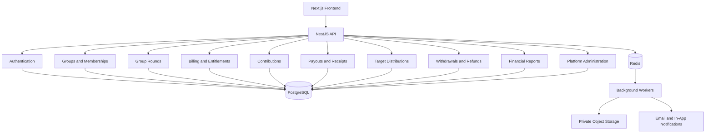

# 10 — API Implementation and Backend Development Blueprint

## 1. Document Purpose

This document defines how to implement the Adashi backend using NestJS, TypeScript, PostgreSQL, TypeORM, Redis, and BullMQ.

It translates the previous product, architecture, API, and database documents into an actionable backend development blueprint.

The backend must support:

- User authentication and account management.
- Group creation and management.
- Group memberships.
- Rotational and target-based Adashi.
- Group rounds.
- One-time group purchases.
- Free Starter entitlement.
- Contributions and verification.
- Payouts and confirmation.
- Payout receipts.
- Withdrawals and refunds.
- Financial reporting.
- Notifications.
- Audit logs.
- Platform administration.

The backend should be implemented as a modular monolith rather than multiple independent microservices.

---

## 2. Recommended Technology Stack

| Area | Technology |
|---|---|
| Runtime | Node.js |
| Language | TypeScript |
| Backend framework | NestJS |
| Database | PostgreSQL |
| ORM | TypeORM |
| Authentication | JWT |
| Validation | class-validator and class-transformer |
| API documentation | Swagger |
| Cache | Redis |
| Background jobs | BullMQ |
| File storage | Private object storage |
| Receipt generation | PDF generation library |
| Testing | Jest and Supertest |
| Logging | NestJS Logger or structured logging |
| API format | REST JSON |

Use stable, mutually compatible versions and keep dependencies updated through controlled upgrades.

---

## 3. Backend Architecture

The backend follows a modular monolith architecture.

Each module owns a specific business domain and exposes services to other modules where necessary.



### Architecture rules

1. Controllers handle HTTP requests and responses.
2. Services contain business logic.
3. DTOs validate incoming requests.
4. Entities represent database records.
5. Guards and policies enforce permissions.
6. Background workers handle asynchronous tasks.
7. Financial operations use database transactions.
8. The backend is the source of truth for business rules and financial calculations.

---

## 4. Recommended Project Folder Structure

```text
adashi-api/
├── src/
│   ├── main.ts
│   ├── app.module.ts
│   │
│   ├── config/
│   │   ├── configuration.ts
│   │   ├── database.config.ts
│   │   ├── jwt.config.ts
│   │   └── redis.config.ts
│   │
│   ├── common/
│   │   ├── decorators/
│   │   ├── guards/
│   │   ├── filters/
│   │   ├── interceptors/
│   │   ├── pipes/
│   │   ├── enums/
│   │   ├── interfaces/
│   │   └── utils/
│   │
│   ├── database/
│   │   ├── migrations/
│   │   ├── seeds/
│   │   └── data-source.ts
│   │
│   ├── modules/
│   │   ├── auth/
│   │   ├── users/
│   │   ├── groups/
│   │   ├── memberships/
│   │   ├── rounds/
│   │   ├── billing/
│   │   ├── entitlements/
│   │   ├── contributions/
│   │   ├── cycles/
│   │   ├── payouts/
│   │   ├── receipts/
│   │   ├── distributions/
│   │   ├── withdrawals/
│   │   ├── refunds/
│   │   ├── notifications/
│   │   ├── reports/
│   │   ├── audit/
│   │   ├── outbox/
│   │   └── admin/
│   │
│   └── workers/
│       ├── receipts/
│       ├── notifications/
│       └── reminders/
│
├── test/
│   ├── auth/
│   ├── groups/
│   ├── billing/
│   ├── contributions/
│   ├── payouts/
│   └── financial/
│
├── .env.example
├── .gitignore
├── nest-cli.json
├── package.json
├── tsconfig.json
└── README.md
```

Each feature module should have a consistent internal structure:

```text
module-name/
├── dto/
├── entities/
├── enums/
├── interfaces/
├── module-name.controller.ts
├── module-name.service.ts
└── module-name.module.ts
```

Keep the structure consistent across modules.

---

## 5. Authentication and User Management

### 5.1 Authentication requirements

Implement:

- User registration.
- Email or phone verification.
- Login.
- Logout.
- Refresh token rotation.
- Forgot password.
- Reset password.
- Current user profile.
- Profile updates.
- Account status management.

The exact verification channel can be configured for the initial launch.

### 5.2 User roles and permissions

Do not make organiser and member mutually exclusive global user roles.

A user can be:
- Organiser of Group A.
- Member of Group B.
- Organiser and member of different groups simultaneously.

Use group membership relationships to determine group-level permissions.

Platform roles should remain separate:

```text
USER
SUPER_ADMIN
PLATFORM_SUPPORT
PLATFORM_FINANCE
```

Group-level permissions should be derived from membership and group ownership.

### 5.3 Authentication endpoints

| Method | Endpoint | Description |
|---|---|---|
| POST | `/auth/register` | Register |
| POST | `/auth/login` | Login |
| POST | `/auth/logout` | Logout |
| POST | `/auth/refresh` | Refresh session |
| POST | `/auth/verify` | Verify account |
| POST | `/auth/forgot-password` | Request reset |
| POST | `/auth/reset-password` | Reset password |
| GET | `/users/me` | Current user |
| PATCH | `/users/me` | Update profile |

### 5.4 Security requirements

- Hash passwords using Argon2id or an appropriately configured password hashing algorithm.
- Use short-lived access tokens.
- Rotate refresh tokens.
- Store refresh tokens securely.
- Revoke sessions on logout.
- Rate-limit login and password reset endpoints.
- Never log passwords, tokens, or reset secrets.

For browser authentication, prefer secure, HTTP-only cookies with appropriate SameSite and CSRF protections.

---

## 6. Groups Module

### 6.1 Responsibilities

The Groups module manages:

- Group creation.
- Group profile.
- Group settings.
- Group type.
- Contribution rules.
- Collection method.
- Organiser ownership.
- Group activation state.
- Group closure.

### 6.2 Group types

```text
ROTATIONAL
TARGET_BASED
```

### 6.3 Collection methods

```text
ORGANISER_COLLECTION
DIRECT_BENEFICIARY_COLLECTION
```

### 6.4 Endpoints

| Method | Endpoint | Description |
|---|---|---|
| POST | `/groups` | Create group |
| GET | `/groups` | List accessible groups |
| GET | `/groups/:groupId` | Get group details |
| PATCH | `/groups/:groupId` | Update group settings |
| POST | `/groups/:groupId/close` | Close group |
| GET | `/groups/:groupId/summary` | Group overview |

### 6.5 Group creation DTO

```typescript
export class CreateGroupDto {
  @IsString()
  @MinLength(3)
  @MaxLength(100)
  name: string;

  @IsEnum(GroupType)
  type: GroupType;

  @IsEnum(CollectionMethod)
  collectionMethod: CollectionMethod;

  @IsOptional()
  @IsString()
  description?: string;

  @IsOptional()
  @IsObject()
  rules?: Record<string, unknown>;
}
```

The actual DTO should validate type-specific rules and reject unknown or unsupported properties.

---

## 7. Memberships Module

### 7.1 Responsibilities

- Invite members.
- Accept or reject invitations.
- List members.
- View membership details.
- Update membership status.
- Manage beneficiary order.
- Request member removal or withdrawal.
- Enforce group-level access.

### 7.2 Membership statuses

```text
INVITED
PENDING
ACTIVE
WITHDRAWAL_PENDING
WITHDRAWN
REMOVED
```

Use explicit membership states and transitions.

### 7.3 Endpoints

| Method | Endpoint | Description |
|---|---|---|
| POST | `/groups/:groupId/invitations` | Invite member |
| GET | `/groups/:groupId/invitations` | List invitations |
| POST | `/invitations/:invitationId/accept` | Accept invitation |
| POST | `/invitations/:invitationId/reject` | Reject invitation |
| GET | `/groups/:groupId/members` | List members |
| GET | `/groups/:groupId/members/:membershipId` | Member details |
| PATCH | `/groups/:groupId/members/:membershipId` | Update permitted membership fields |

The organiser must not be allowed to add members beyond the purchased plan's limit.

---

## 8. Group Rounds Module

### 8.1 Responsibilities

- Create a new round under an existing group.
- Retrieve round history.
- Activate rounds after valid entitlement or purchase.
- Manage round status.
- Complete or cancel rounds.
- Prevent financial history from crossing round boundaries.

### 8.2 Round statuses

```text
DRAFT
PENDING_PAYMENT
ACTIVE
IN_PROGRESS
AWAITING_DISTRIBUTION
COMPLETED
CANCELLED
```

### 8.3 Endpoints

| Method | Endpoint | Description |
|---|---|---|
| POST | `/groups/:groupId/rounds` | Create round |
| GET | `/groups/:groupId/rounds` | List rounds |
| GET | `/rounds/:roundId` | Round details |
| POST | `/rounds/:roundId/activate` | Activate eligible round |
| POST | `/rounds/:roundId/complete` | Complete round |
| POST | `/rounds/:roundId/cancel` | Cancel round |
| GET | `/rounds/:roundId/summary` | Round summary |

Round activation must be controlled by the billing and entitlement workflow.

Do not expose a general activation endpoint that bypasses purchase verification or free entitlement validation.

---

## 9. Billing and Entitlements Modules

### 9.1 Billing responsibilities

- Retrieve available plans.
- Calculate purchase amounts.
- Create group purchases.
- Record payment reports.
- Verify purchase payments.
- Process upgrades.
- Maintain purchase history.

### 9.2 Billing endpoints

| Method | Endpoint | Description |
|---|---|---|
| GET | `/billing/plans` | List active plans |
| GET | `/billing/plans/:planId` | Plan details |
| POST | `/billing/purchases` | Create purchase |
| GET | `/billing/purchases` | Organiser purchase history |
| GET | `/billing/purchases/:purchaseId` | Purchase details |
| POST | `/billing/purchases/:purchaseId/payments` | Report purchase payment |
| POST | `/billing/purchases/:purchaseId/verify` | Verify payment, platform finance/admin |
| POST | `/billing/purchases/:purchaseId/upgrade` | Request plan upgrade |

The frontend must never supply the authoritative purchase price.

The backend retrieves the active plan and calculates the amount.

### 9.3 Entitlement endpoints

| Method | Endpoint | Description |
|---|---|---|
| GET | `/entitlements/me` | Get current user's entitlement |
| POST | `/entitlements/reserve` | Reserve free activation |
| POST | `/entitlements/activate` | Consume entitlement and activate round |
| POST | `/entitlements/release` | Release an eligible expired/failed reservation |

Reservation release must be restricted to valid reservation states and expiry conditions.

### 9.4 Critical billing rules

- A group purchase cannot activate a round before verification.
- A free entitlement cannot be consumed more than once.
- A consumed entitlement cannot be restored through normal cancellation.
- An upgrade must charge only the calculated difference.
- All purchase and activation actions must be idempotent.

---

## 10. Contributions Module

### 10.1 Responsibilities

- Create expected contributions.
- List member contributions.
- Report payments.
- Upload payment evidence.
- Verify payments.
- Reject payment reports.
- Reverse verified contributions through controlled correction.

### 10.2 Endpoints

| Method | Endpoint | Description |
|---|---|---|
| GET | `/rounds/:roundId/contributions` | List round contributions |
| GET | `/contributions/:contributionId` | Contribution details |
| POST | `/contributions/:contributionId/report` | Report payment |
| POST | `/contributions/:contributionId/evidence` | Attach evidence |
| POST | `/contributions/:contributionId/verify` | Verify contribution |
| POST | `/contributions/:contributionId/reject` | Reject report |
| POST | `/contributions/:contributionId/reverse` | Request or perform authorised reversal |
| GET | `/memberships/:membershipId/contributions` | Member contribution history |

### 10.3 Report contribution DTO

```typescript
export class ReportContributionDto {
  @IsNumberString()
  amount: string;

  @IsDateString()
  paymentDate: string;

  @IsOptional()
  @IsString()
  paymentReference?: string;

  @IsOptional()
  @IsString()
  paymentChannel?: string;

  @IsOptional()
  @IsString()
  note?: string;
}
```

Money should be represented as decimal strings in API payloads.

Do not use JavaScript floating-point values for monetary calculations.

### 10.4 Verification rules

Only the authorised organiser or an explicitly delegated group financial reviewer may verify a contribution.

Members cannot verify their own payment reports.

The backend must validate:
- Membership ownership.
- Group ownership.
- Contribution state.
- Reported amount.
- Permitted contribution schedule.
- Whether the contribution has already been verified or reversed.

---

## 11. Rotational Cycles Module

### 11.1 Responsibilities

- Generate contribution cycles.
- Assign beneficiaries.
- Maintain payout order.
- Track cycle contributions.
- Determine cycle readiness.
- Track cycle completion.

### 11.2 Supported schedules

```text
DAILY
WEEKLY
BIWEEKLY
EVERY_THREE_WEEKS
MONTHLY
```

Use explicit date calculation rules and store generated due dates.

Do not rely on a frontend calendar to determine the authoritative schedule.

### 11.3 Endpoints

| Method | Endpoint | Description |
|---|---|---|
| GET | `/rounds/:roundId/cycles` | List cycles |
| GET | `/cycles/:cycleId` | Cycle details |
| POST | `/rounds/:roundId/cycles/generate` | Generate cycles |
| GET | `/cycles/:cycleId/contributions` | Cycle contributions |
| POST | `/cycles/:cycleId/complete` | Complete eligible cycle |

Cycle generation must be idempotent and must not create duplicate cycles when retried.

---

## 12. Payouts Module

### 12.1 Responsibilities

- Create payout obligations.
- Retrieve payout records.
- Mark payouts as sent.
- Confirm receipt as beneficiary.
- Confirm on behalf after 48 hours.
- Open payout disputes.
- Resolve disputes.
- Maintain payout event history.

### 12.2 Endpoints

| Method | Endpoint | Description |
|---|---|---|
| GET | `/rounds/:roundId/payouts` | List round payouts |
| GET | `/payouts/:payoutId` | Payout details |
| POST | `/payouts/:payoutId/mark-sent` | Mark payout as sent |
| POST | `/payouts/:payoutId/confirm-received` | Beneficiary confirms |
| POST | `/payouts/:payoutId/confirm-on-behalf` | Organiser override after deadline |
| POST | `/payouts/:payoutId/dispute` | Beneficiary disputes payout |
| GET | `/payouts/:payoutId/events` | Payout history |
| POST | `/payouts/:payoutId/resolve-dispute` | Authorised dispute resolution |

### 12.3 Mark payout as sent DTO

```typescript
export class MarkPayoutSentDto {
  @IsNumberString()
  amountSent: string;

  @IsDateString()
  paymentDate: string;

  @IsOptional()
  @IsString()
  paymentReference?: string;

  @IsOptional()
  @IsString()
  paymentMethod?: string;

  @IsOptional()
  @IsString()
  note?: string;
}
```

### 12.4 Member confirmation DTO

```typescript
export class ConfirmPayoutDto {
  @IsOptional()
  @IsString()
  note?: string;
}
```

### 12.5 Organiser override DTO

```typescript
export class ConfirmPayoutOnBehalfDto {
  @IsString()
  @MinLength(5)
  reason: string;

  @IsOptional()
  @IsString()
  paymentReference?: string;
}
```

### 12.6 Payout business rules

The backend must enforce:

- Only the organiser can mark an eligible payout as sent.
- Only the beneficiary can personally confirm receipt.
- Confirmation deadline is calculated from the server-side `sentAt`.
- Organiser override is blocked before 48 hours.
- Override reason is mandatory.
- An organiser override is recorded as `CONFIRMED_BY_ORGANISER`.
- A beneficiary may dispute a payout after organiser override.
- Disputed payouts must not automatically advance affected financial workflows.

Do not accept a client-supplied `confirmationDeadline` as authoritative.

---

## 13. Receipts Module

### 13.1 Responsibilities

- Create receipt records.
- Generate PDF receipts.
- Maintain receipt versions.
- Provide authorised receipt downloads.
- Retry failed PDF generation.

### 13.2 Endpoints

| Method | Endpoint | Description |
|---|---|---|
| GET | `/payouts/:payoutId/receipt` | Get payout receipt |
| GET | `/receipts/:receiptId` | Receipt details |
| GET | `/receipts/:receiptId/download` | Download PDF |
| POST | `/receipts/:receiptId/regenerate` | Authorised regeneration |

### 13.3 Receipt workflow

When a payout is marked sent:

1. Create receipt record inside the payout transaction.
2. Insert a receipt-generation outbox event.
3. Commit the database transaction.
4. Worker generates the PDF.
5. Worker uploads the PDF to private object storage.
6. Receipt status changes to `AVAILABLE`.
7. Authorised users are notified.

Receipt generation failure must not roll back a valid payout record.

The receipt must state that the organiser recorded the payout as sent. It must not falsely imply independent bank settlement verification.

---

## 14. Target Distributions Module

### 14.1 Responsibilities

- Calculate distributable funds.
- Determine eligible members.
- Calculate equal shares.
- Handle rounding.
- Submit distribution for approval.
- Approve distribution.
- Create member payout obligations.

### 14.2 Endpoints

| Method | Endpoint | Description |
|---|---|---|
| GET | `/rounds/:roundId/distribution` | Distribution summary |
| POST | `/rounds/:roundId/distribution/calculate` | Calculate distribution |
| POST | `/rounds/:roundId/distribution/submit` | Submit for approval |
| POST | `/rounds/:roundId/distribution/approve` | Approve distribution |
| GET | `/distributions/:distributionId` | Distribution details |
| GET | `/distributions/:distributionId/items` | Member allocations |

### 14.3 Distribution rules

- Only verified contributions count.
- Distribution is equal among eligible members.
- Eligibility must account for approved withdrawals.
- Blocking disputes must be resolved.
- Rounding must be deterministic.
- Distribution approval must be transactional.
- Each eligible member must receive only one distribution item per distribution.

The frontend may preview calculations, but the backend must recalculate and validate them during approval.

---

## 15. Withdrawals and Refunds Modules

### 15.1 Withdrawal endpoints

| Method | Endpoint | Description |
|---|---|---|
| POST | `/memberships/:membershipId/withdrawals` | Request withdrawal |
| GET | `/memberships/:membershipId/withdrawals` | Member withdrawal history |
| GET | `/rounds/:roundId/withdrawals` | Organiser withdrawal list |
| GET | `/withdrawals/:withdrawalId` | Withdrawal details |
| POST | `/withdrawals/:withdrawalId/approve` | Approve request |
| POST | `/withdrawals/:withdrawalId/reject` | Reject request |
| GET | `/withdrawals/:withdrawalId/settlement` | Settlement calculation |

### 15.2 Refund endpoints

| Method | Endpoint | Description |
|---|---|---|
| GET | `/settlements/:settlementId` | Settlement details |
| POST | `/settlements/:settlementId/approve` | Approve settlement |
| POST | `/settlements/:settlementId/refunds` | Create refund record |
| POST | `/refunds/:refundId/mark-sent` | Record refund as sent |
| POST | `/refunds/:refundId/confirm` | Confirm refund receipt |

### 15.3 Settlement rules

The backend must calculate settlements from authoritative records.

Do not allow the frontend to submit an arbitrary refund amount as the final settlement.

For rotational groups, account for previous payouts and outstanding obligations.

For target-based groups, calculate refundable verified contributions and adjust eligibility for future distribution.

---

## 16. Notifications Module

### 16.1 Responsibilities

- In-app notifications.
- Email notifications.
- Push notifications where supported.
- Notification preferences.
- Read/unread state.
- Retry failed delivery.

### 16.2 Endpoints

| Method | Endpoint | Description |
|---|---|---|
| GET | `/notifications` | List notifications |
| GET | `/notifications/unread-count` | Unread count |
| PATCH | `/notifications/:notificationId/read` | Mark as read |
| PATCH | `/notifications/read-all` | Mark all as read |
| GET | `/notifications/preferences` | Notification settings |
| PATCH | `/notifications/preferences` | Update preferences |

Notifications must not be used as evidence that a payment was made or received.

---

## 17. Financial Reports Module

### 17.1 Member endpoints

| Method | Endpoint | Description |
|---|---|---|
| GET | `/memberships/:membershipId/financial-summary` | Personal financial summary |
| GET | `/memberships/:membershipId/transactions` | Personal financial history |

### 17.2 Organiser endpoints

| Method | Endpoint | Description |
|---|---|---|
| GET | `/groups/:groupId/financial-summary` | Group summary |
| GET | `/rounds/:roundId/financial-summary` | Round summary |
| GET | `/rounds/:roundId/contribution-report` | Contribution report |
| GET | `/rounds/:roundId/payout-report` | Payout report |
| GET | `/rounds/:roundId/outstanding-report` | Outstanding obligations |
| GET | `/rounds/:roundId/withdrawal-report` | Withdrawal and refund report |
| GET | `/rounds/:roundId/reconciliation` | Financial reconciliation |

### 17.3 Reporting rules

- Members see only authorised personal information.
- Organisers see only their own groups.
- Platform administrators see platform-level financial data according to their permissions.
- Financial totals must be derived from valid underlying records.
- Reversed transactions must be excluded from valid totals while remaining visible in history.

---

## 18. Platform Administration Module

### 18.1 Responsibilities

- Manage users.
- Manage groups where operationally necessary.
- Manage billing plans.
- Verify manual group purchases.
- View platform revenue.
- Manage platform configuration.
- Review authorised support cases.
- Review audit records.

### 18.2 Endpoints

| Method | Endpoint | Description |
|---|---|---|
| GET | `/admin/dashboard` | Platform overview |
| GET | `/admin/users` | User management |
| GET | `/admin/groups` | Group management |
| GET | `/admin/purchases` | Purchase management |
| POST | `/admin/purchases/:purchaseId/verify` | Verify purchase payment |
| GET | `/admin/revenue` | Platform revenue report |
| GET | `/admin/plans` | Manage billing plans |
| POST | `/admin/plans` | Create plan |
| PATCH | `/admin/plans/:planId` | Update plan |
| GET | `/admin/audit-logs` | Audit review |

Administrative endpoints must require explicit platform permissions.

Group organisers must not gain platform administration privileges.

---

## 19. Authorization Strategy

Use NestJS guards and group-level access policies.

Recommended components:

```text
common/
├── guards/
│   ├── jwt-auth.guard.ts
│   ├── platform-role.guard.ts
│   └── group-access.guard.ts
│
├── decorators/
│   ├── current-user.decorator.ts
│   ├── platform-roles.decorator.ts
│   └── public.decorator.ts
```

### Authorization principles

1. Authenticate the user.
2. Identify the requested group, round, or membership.
3. Verify that the user has access to the resource.
4. Verify the required group-level permission.
5. Verify the requested state transition.
6. Execute the operation transactionally where required.

Never rely on a frontend-hidden button as an access-control mechanism.

For example, the backend must independently verify that the authenticated user is the beneficiary before allowing payout confirmation.

---

## 20. API Response Standards

Use a consistent response structure.

### Successful response

```json
{
  "success": true,
  "message": "Contribution verified successfully",
  "data": {
    "id": "contribution-uuid",
    "status": "VERIFIED",
    "verifiedAt": "2026-11-07T10:30:00.000Z"
  }
}
```

### Error response

```json
{
  "success": false,
  "message": "Contribution is not awaiting verification",
  "errorCode": "CONTRIBUTION_INVALID_STATE"
}
```

### Pagination

Use a consistent pagination structure:

```json
{
  "success": true,
  "data": [],
  "meta": {
    "page": 1,
    "limit": 20,
    "total": 0,
    "totalPages": 0
  }
}
```

Use standard HTTP status codes and stable application error codes.

Do not expose internal database errors or stack traces to clients.

---

## 21. Validation and Error Handling

Every endpoint must validate:
- UUID parameters.
- Request body properties.
- Monetary values.
- Date values.
- Enum values.
- File type and size.
- User permissions.
- Resource ownership.
- Allowed state transitions.

Recommended global validation pipe:

```typescript
app.useGlobalPipes(
  new ValidationPipe({
    whitelist: true,
    forbidNonWhitelisted: true,
    transform: true,
  }),
);
```

Use a global exception filter or consistent exception handling strategy.

Financial errors should return meaningful application error codes.

Examples:

```text
INSUFFICIENT_GROUP_PLAN_LIMIT
FREE_ENTITLEMENT_ALREADY_USED
PURCHASE_NOT_VERIFIED
CONTRIBUTION_ALREADY_VERIFIED
PAYOUT_NOT_ELIGIBLE
PAYOUT_CONFIRMATION_DEADLINE_NOT_REACHED
PAYOUT_ALREADY_CONFIRMED
PAYOUT_DISPUTED
DUPLICATE_REFUND
SETTLEMENT_NOT_APPROVED
```

---

## 22. API Security Requirements

Implement:

- HTTPS in production.
- JWT authentication.
- Secure refresh token handling.
- Rate limiting.
- DTO validation.
- CORS restrictions.
- File upload validation.
- Private evidence storage.
- Role and resource-level authorization.
- Audit logging.
- Idempotency keys for critical operations.
- Database transactions.
- Protection against mass assignment.
- Secure environment variable handling.

Never trust:
- Client-supplied user IDs for the acting user.
- Client-supplied purchase prices.
- Client-supplied payout deadlines.
- Client-supplied financial totals.
- Client-supplied group ownership.
- Client-supplied confirmation status.

Derive these values from authenticated identity and authoritative database records.

---

## 23. Background Worker Architecture

Create dedicated workers for:

### Receipt worker

- Generate PDF.
- Upload to private storage.
- Update receipt status.
- Retry failed jobs safely.

### Notification worker

- Send email.
- Deliver in-app notifications.
- Deliver push notifications where supported.
- Retry failed deliveries.

### Reminder worker

- Contribution reminders.
- Upcoming due-date reminders.
- Overdue contribution reminders.
- Payout confirmation deadline reminders.

### Reconciliation worker

Future scope:
- Process provider transaction notifications.
- Match payment references.
- Identify discrepancies.
- Update verified provider payment records.

All workers must be idempotent.

---

## 24. Testing Strategy

Use a combination of unit, integration, and end-to-end tests.

### Unit tests

Test:
- Contribution verification rules.
- Payout state transitions.
- 48-hour deadline calculation.
- Entitlement eligibility.
- Upgrade calculations.
- Equal distribution and rounding.
- Withdrawal settlement calculations.

### Integration tests

Test:
- TypeORM transactions.
- Database constraints.
- Foreign key relationships.
- Unique indexes.
- Row-level locking.
- Idempotency.
- Outbox event creation.

### End-to-end tests

Test complete workflows:

1. Register user.
2. Create group.
3. Use free entitlement.
4. Invite members.
5. Start round.
6. Report contributions.
7. Verify contributions.
8. Generate rotational cycles or target distribution.
9. Mark payouts sent.
10. Confirm payout as beneficiary.
11. Generate receipt.
12. Request withdrawal.
13. Complete settlement.
14. Complete round.

Include negative tests for unauthorised actions and invalid state transitions.

---

## 25. Environment Configuration

Create `.env.example`:

```env
NODE_ENV=development
PORT=4000
API_PREFIX=api/v1

DATABASE_HOST=localhost
DATABASE_PORT=5432
DATABASE_USER=postgres
DATABASE_PASSWORD=
DATABASE_NAME=adashi_db

JWT_ACCESS_SECRET=
JWT_ACCESS_EXPIRES_IN=15m
JWT_REFRESH_SECRET=
JWT_REFRESH_EXPIRES_IN=7d

REDIS_HOST=localhost
REDIS_PORT=6379
REDIS_PASSWORD=

APP_URL=http://localhost:3000
API_URL=http://localhost:4000

STORAGE_PROVIDER=
STORAGE_BUCKET=
STORAGE_REGION=
STORAGE_ACCESS_KEY=
STORAGE_SECRET_KEY=

EMAIL_PROVIDER=
EMAIL_FROM=

LOG_LEVEL=debug
```

The exact storage and email provider can be selected during deployment.

Never commit actual secrets to GitHub.

Validate required environment variables during application startup.

---

## 26. API Versioning and Documentation

Use a versioned API prefix:

```text
/api/v1
```

Configure Swagger documentation.

Swagger should document:
- Authentication.
- DTO schemas.
- Response schemas.
- Error responses.
- Authorization requirements.
- Pagination.
- File upload requirements.
- Important state transitions.

Keep Swagger documentation aligned with actual endpoint behaviour.

---

## 27. Development Phases

### Phase 1 — Foundation

Implement:
- NestJS setup.
- PostgreSQL connection.
- TypeORM migrations.
- Configuration validation.
- Authentication.
- Users.
- Swagger.
- Global validation and error handling.

### Phase 2 — Groups and memberships

Implement:
- Groups.
- Group settings.
- Memberships.
- Invitations.
- Group-level authorization.
- Group rounds.

### Phase 3 — Billing and activation

Implement:
- Billing plans.
- Group purchases.
- Manual payment reporting and verification.
- Free Starter entitlement.
- Plan upgrades.
- Round activation.

### Phase 4 — Contributions

Implement:
- Expected contribution generation.
- Payment reporting.
- Evidence uploads.
- Verification.
- Rejection.
- Reversal.

### Phase 5 — Rotational Adashi

Implement:
- Contribution schedules.
- Cycle generation.
- Beneficiary ordering.
- Cycle readiness.
- Cycle progression.

### Phase 6 — Payouts and receipts

Implement:
- Payout obligations.
- Mark as sent.
- Member confirmation.
- 48-hour organiser override.
- Disputes.
- Automatic receipt creation.
- PDF generation.

### Phase 7 — Target-based Adashi

Implement:
- Target tracking.
- Eligibility calculation.
- Equal distribution.
- Rounding.
- Approval.
- Payout creation.

### Phase 8 — Withdrawals and refunds

Implement:
- Withdrawal requests.
- Settlement calculations.
- Approval and rejection.
- Refund processing.
- Withdrawal completion.

### Phase 9 — Notifications and reports

Implement:
- In-app notifications.
- Email notifications.
- Background workers.
- Financial dashboards.
- Reconciliation reports.

### Phase 10 — Hardening and deployment

Implement:
- Security review.
- Concurrency tests.
- Financial integrity tests.
- Performance tests.
- Logging and monitoring.
- Backup and recovery procedures.
- Production deployment.

---

## 28. Backend Definition of Done

The backend MVP is ready for frontend integration when:

1. All major modules are implemented.
2. Authentication and authorization work correctly.
3. Groups and memberships are manageable.
4. Group rounds preserve historical records.
5. Billing and free entitlement rules are enforced.
6. Contribution reports and verification work.
7. Rotational schedules and cycles work.
8. Target-based distributions calculate correctly.
9. Payouts follow the required state transitions.
10. The 48-hour override is enforced by the backend.
11. Every payout marked sent creates a receipt record.
12. PDF receipts can be generated and downloaded.
13. Withdrawals and refunds preserve financial history.
14. Financial summaries are accurate.
15. Audit logs record important operations.
16. Critical financial operations are transactional and idempotent.
17. Swagger documentation is available.
18. Automated tests cover core workflows.
19. Environment variables and production configuration are validated.
20. No critical financial operation relies on frontend validation alone.

---

## 29. Final Implementation Guidance

Build the backend in phases rather than attempting every module simultaneously.

The recommended priority is:

1. Authentication and database foundation.
2. Groups, memberships, and rounds.
3. Billing and entitlement.
4. Contributions.
5. Rotational cycles.
6. Payouts and receipts.
7. Target-based distributions.
8. Withdrawals and refunds.
9. Notifications and reports.
10. Security, testing, and deployment.

Keep the system modular, but avoid unnecessary microservices or premature abstractions.

The most important requirement is financial correctness: every contribution, payout, refund, and settlement must have a traceable history and must follow the rules defined in the previous project documents.